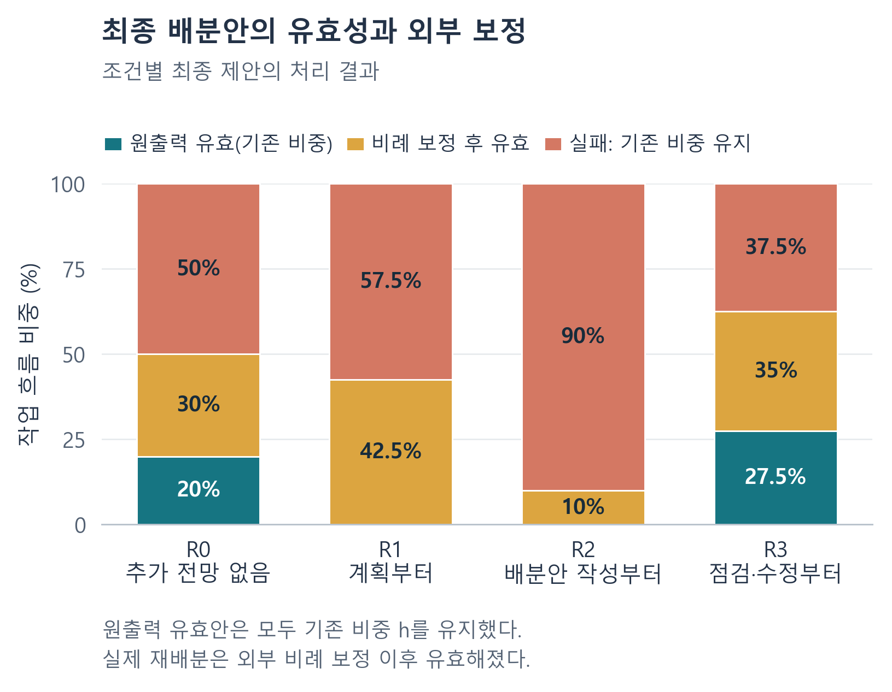
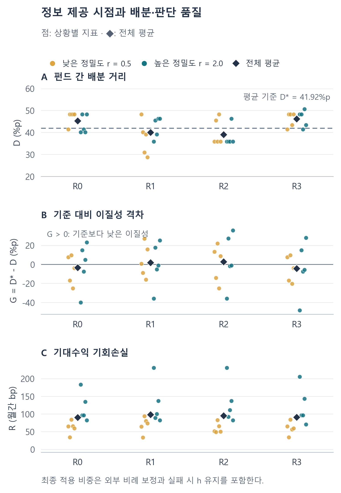

# LIBERA 본실험 결과 해석

**기관별 근거가 유효한 투자판단으로 이어지는 조건**

2026년 10월 29일 · 완료된 B-main 결과에 대한 해석본

## 1. 이번 결과가 말해 주는 것

이번 본실험의 핵심은 펀드별 자료의 제공 시점이 배분의 실행 가능성을 바꾸었고, 그 변화가 실제 투자판단의 개선과는 다른 양상으로 나타났다는 점이다. 최종 점검 때 자료를 제공한 R3는 가장 높은 유효율을 보였다. 그러나 원출력부터 유효한 안은 모두 기존 보유비중을 유지한 배분이었고, 실제 재배분은 외부 정규화를 거친 안에서 나왔다. 자료를 전달하고 유효한 답변을 받는 일에서, 새로운 정보를 반영한 적합한 배분으로 나아가는 연결이 연구의 중심 결과다.

원초록이 제기한 문제는 공통 AI가 서로 다른 기관에 필요한 판단 차이를 약화시킬 수 있다는 것이었다. 관측 결과에서는 기준보다 작은 차이와 더 큰 차이가 모두 나타났다. 이때 차이가 크다고 판단 품질이 높아지지는 않았으며, 실패에 따라 기존 비중을 유지하는 경로도 펀드 간 차이를 남겼다. 따라서 이번 결과는 기관별 전략의 보존을 **근거 전달, 유효한 변경, 경제적 적합성**으로 함께 평가하는 근거가 된다.

## 2. 정보 제공 시점의 효과

조건은 펀드별 추가 전망을 주지 않는 R0, 계획부터 제공하는 R1, 배분안 작성부터 제공하는 R2, 최종 점검부터 제공하는 R3다. 같은 펀드·상황에서는 동일한 검색 패킷을 사용했고, 받은 근거와 이전 응답을 이후 단계에서도 유지했다.

| 자료 제공 조건 | 원출력 유효 | 정규화 후 유효 | 실패·기존 비중 유지 | 전체 유효율 |
| --- | --- | --- | --- | --- |
| R0 | 20.0% | 30.0% | 50.0% | 50.0% |
| R1 | 0.0% | 42.5% | 57.5% | 42.5% |
| R2 | 0.0% | 10.0% | 90.0% | 10.0% |
| R3 | 27.5% | 35.0% | 37.5% | 62.5% |

*주: 원출력 유효와 정규화 후 유효는 서로 겹치지 않는 범주다. 전체 유효율은 두 범주의 합이다.*

R3의 유효율은 R0보다 12.5%p 높았고 R2보다 52.5%p 높았다. 점검 단계의 첫 근거 제공이 유효한 최종 응답 비율이 가장 높았던 배치였다. 이 유효 응답에는 기존 보유를 유지하는 답변도 포함돼 있다. 실제 재배분 비율은 R1 42.5%, R3 35.0%, R0 30.0%, R2 10.0%였다. 유효율의 순위와 실제 변경의 순위부터 다르다.

원출력이 유효했던 안은 모두 기존 h와 수치적으로 같았다. 실패 처리로 h를 유지한 안까지 합하면 최종 적용 비중의 70.6%가 기존 상태를 유지했다. 기관별 전략의 차이가 남았더라도 그 차이가 원래 보유상태에서 온 것인지, 모델이 새 근거에 반응해 만든 것인지 구분해야 하는 이유다.

## 3. 이질성의 축소·확대와 판단 품질

펀드 간 배분 거리의 수리 기준은 평균 41.92%p였다. R1·R2는 이보다 작은 거리를, R0·R3는 더 큰 거리를 보였다. 공통 모델의 결과는 정보의 배치에 따라 수렴과 확대를 함께 나타냈다.

| 평가 지표 | R0 미제공 | R1 계획 | R2 배분안 | R3 점검 |
| --- | --- | --- | --- | --- |
| 펀드 간 배분 거리 D (%p) | 45.26 | 40.00 | 39.07 | 46.15 |
| 기준배분 거리 D* (%p) | 41.92 | 41.92 | 41.92 | 41.92 |
| 과잉수렴 격차 G (%p) | -3.34 | 1.92 | 2.85 | -4.23 |
| 거리 오차 A (%p) | 28.10 | 26.44 | 25.46 | 29.48 |
| 차이 방향의 불일치 E (%p) | 70.25 | 68.09 | 67.95 | 70.11 |
| 월간 기대수익 손실 R (bp) | 90.16 | 98.37 | 95.28 | 91.20 |

*주: G가 양수이면 기준보다 펀드 간 차이가 작다. A와 E는 배분의 차이가 기준에서 얼마나 어긋나는지 나타낸다. R은 합성 전망 아래의 월간 기대수익 손실로 실현 수익률과 다르다. 낮을수록 수리 기준에 가깝다.*

R1과 R2의 평균 과잉수렴 격차는 양수였지만 발생 경로가 같지는 않았다. R2는 실패 후 기존 보유를 유지하는 비율이 높았고, 양의 격차의 약 72.5%가 실패가 포함된 펀드 쌍의 기여였다. R1에서는 정규화로 살아남은 배분이 포함된 쌍의 수렴 기여와 실패 포함 쌍의 반대 방향 기여가 합쳐졌다. 실패율을 함께 제시하면 같은 거리 수치가 나타내는 운영 결과의 차이를 읽을 수 있다.

R3는 가장 큰 배분 거리를 보이면서 유효율도 가장 높았다. 그러나 기준의 산업별 차이와 어긋나는 정도는 크게 남았고, 평균 기대수익 손실은 R0보다 낮아지지 않았다. 원초록의 ‘완화효과’는 이 두 평가가 함께 좋아지는지를 묻는 개념으로 유지해야 한다. 본실험은 후기 제공의 유효성 개선과 판단 품질 개선을 구분하는 결과를 제공했다.

기존 보유를 전부 유지했을 때의 계산 기준도 중요한 비교다. 모든 조건의 평균 기대수익 손실이 이 기준을 웃돌았다. 따라서 전체 평균에서 실제 변경이 만들어낸 경제적 개선은 확인되지 않았으며, 일부 배분의 유효성 회복과 실제 변경을 그 자체의 성과로 정확히 위치시킬 수 있다.

| 조건·계산 기준 | 월간 기대수익 손실 (bp) | 기존 보유 유지 대비 차이 (bp) |
| --- | --- | --- |
| 기존 보유비중 h 유지 | 87.84 | 0.00 |
| R0 | 90.16 | +2.32 |
| R1 | 98.37 | +10.53 |
| R2 | 95.28 | +7.44 |
| R3 | 91.20 | +3.36 |

## 4. 출력 실패를 논문의 결과로 읽는 방법

### 4.1 목표비중과 변경량의 연결

실패의 주된 유형은 공매도를 허용하지 않는 과제에서 음수 목표비중을 제출한 것이었다. 그중에는 현재 보유비중의 부호를 뒤집은 −h 형태가 반복됐다. 현재 비중을 줄인다는 변경 판단과 최종 보유비중의 값은 서로 다른 대상이다. 이 구분이 출력에서 유지되지 않으면 펀드별 근거가 제시되어도 실행 가능한 배분을 얻지 못한다. 따라서 실패는 근거를 비중으로 옮기는 업무 단계의 진단 자료가 된다.

나머지 실패는 비음수 비중을 정규화한 뒤에도 기존 주식 부문의 위험상한을 넘은 경우였다. 합계를 100%로 맞추는 처리와 위험에 맞는 배분을 만드는 판단이 분리된다는 결과다. 논문에서는 이를 목표비중의 형식·의미, 예산과 위험을 차례로 검증해야 한다는 설계 원칙에 연결한다.

### 4.2 유효한 현상 유지와 새로운 판단

유효한 답변이 h를 그대로 제출한 경우에는 실패 출력이 제거되더라도 운용상태는 그대로 남는다. 특히 점검 단계에서 무효 제안을 h로 바꾼 사례는 출력 유효성을 회복했지만 실제 적용 비중을 바꾸지 않았다. 이 결과는 ‘오류를 없앴다’와 ‘기관별 정보에 맞는 새 판단을 만들었다’를 서로 다른 성과로 평가하게 한다.

기존 비중 유지 자체는 위험을 통제하는 운영 선택이다. 그러나 그 선택이 새 전망에 대한 검토의 결과인지, 모델이 유효한 변경안을 만들지 못해 적용된 정책인지에 따라 의미가 달라진다. 원출력, 정규화 결과와 보유 유지 이력을 함께 기록하면 이 차이를 보존할 수 있다.

### 4.3 점검 결과가 행동으로 이어지는 과정

점검 단계에는 작성 단계의 배분과 외부 제약 검사 결과가 전달됐다. 그럼에도 원비중이 그대로 남는 경우가 많았고, 실제 적용 비중이 바뀐 비율은 6.9%였다. 유효에서 무효로 바뀐 경우도 발생해 최종 유효율은 작성 단계보다 소폭 낮아졌다. 검사 정보를 입력에 추가하는 것과 검사 결과에 따라 최종 배분을 수정하는 것은 구분되는 절차였다.

모델의 선택적 계산도구 호출도 없었다. 외부 코드는 예정된 검사를 수행했으므로 검증 장치는 작동했지만, 모델이 스스로 계산을 요청해 수정안을 확인하는 경로는 사용되지 않았다. 이 결과는 핵심 수치 검증을 선택적 기능으로만 제공하기보다, 배분 확정에 필요한 절차로 연결할 필요를 보여준다.

### 4.4 같은 상황의 사례

main-009의 F01에서는 R0가 −h와 같은 목표비중을 제출해 기존 비중이 유지됐다. R3는 작성 단계의 유사한 무효안을 점검 단계에서 h로 바꾸어 유효성을 회복했다. 두 조건의 적용 비중과 기대수익 손실은 같았다. R1은 정규화를 거쳐 큰 재배분을 만들었지만 손실은 99.41bp에서 113.52bp로 높아졌다. 이 사례는 무효 제안, 유효한 보유 유지와 유효한 재배분 사이의 차이를 하나의 펀드·상황 안에서 보여준다.

## 5. 전망 정밀도와 결과의 일관성

R3가 가장 높은 유효율을, R2가 가장 낮은 유효율을 보인 순서는 두 정밀도 상황군에서 같았다. 수렴 격차의 평균 부호도 같은 방향이었다. 반면 기대수익 손실에서는 낮은 정밀도 상황군의 R2·R3가 R0보다 소폭 낮고, 높은 정밀도 상황군에서는 자료 제공 조건이 모두 R0보다 높았다.

| 전망 정밀도 | 조건 | 유효율 | 과잉수렴 격차 (%p) | 월간 기대수익 손실 (bp) |
| --- | --- | --- | --- | --- |
| r=0.5 | R0 | 60.0% | -5.75 | 61.77 |
| r=0.5 | R1 | 50.0% | 3.72 | 69.10 |
| r=0.5 | R2 | 10.0% | 0.90 | 59.99 |
| r=0.5 | R3 | 65.0% | -4.77 | 59.91 |
| r=2 | R0 | 40.0% | -0.93 | 118.55 |
| r=2 | R1 | 35.0% | 0.11 | 127.64 |
| r=2 | R2 | 10.0% | 4.80 | 130.57 |
| r=2 | R3 | 60.0% | -3.70 | 122.49 |

*주: r은 합성 전망의 오차 공분산을 조절하는 값이다. 정밀도별로 서로 다른 상황을 사용했으므로 각 수준 안의 조건 비교를 우선 해석한다.*

이 결과는 근거의 정밀도와 배분의 실행 가능성 사이에 별도의 전환 과정이 있음을 보여준다. 좋은 정보를 확보한 이후에도 목표비중의 의미, 제약 계산과 수정 절차가 작동해야 한다. 소논문의 대응 방향은 자료의 양이나 검색 성공률에 더해 이 전환 과정을 관리하는 데 둘 수 있다.

## 6. 소논문의 중심 논증과 대응 방향

완성 원고의 논증은 다음과 같이 연결된다. 공통 AI가 여러 중간 업무의 정보 처리 방식을 공유하게 한다. 기관별 전략을 보존하려면 각 펀드의 근거와 제약이 최종 선택까지 이어져야 한다. 본실험에서는 필요한 전망의 검색이 확인됐지만, 유효한 변경과 판단 품질의 공동 개선은 확보되지 않았다. 정보 제공 단계에 따라 달라진 유효성과 수렴, 실패 후 기존 보유 유지는 이 연결을 관찰한 결과다.

대응의 중심은 근거와 변경량을 연결한 배분 확정 절차다. 현재 비중 h와 변경량 Δ를 구분하고 목표비중을 h+Δ로 계산한다. 외부 계산으로 합계와 위험을 확인하고, 위반된 항목을 지정해 재검사한다. 기존 비중을 유지한 경우에는 유지 사유와 새로운 전망을 반영하지 않은 기회비용을 확인한다. 성과는 유효율, 실제 변경과 기준배분 대비 품질을 함께 보고한다.

후속 검증에서는 동일한 입력과 평가 규칙 아래 모델 규모, 필수 계산과 변경량 제출 방식을 구분해 비교할 수 있다. 본실험이 제시하는 것은 개선의 목표와 확인 위치다. 기관별 자료가 전달되는 단계와, 그 자료가 유효한 비중으로 확정되는 단계를 연결하는 것이 Workflow RAG의 실무적 과제다.

## 7. 결과를 읽기 위한 방법 정보

본실험은 네 실제 펀드의 2025년 말 보유자료를 바탕으로 구성한 FF12 주식 부문 배분 과제다. 독립된 합성 상황은 열 개이며, 각 상황에 네 조건을 적용한 160개 업무 흐름이 모두 종료됐다. 원출력 유효 19개, 정규화 구제 47개, 실패 후 보유 유지 94개를 모두 분석했다. 유효성의 범위는 목표비중의 비음수·합계 1·기존 주식 부문 위험상한이며, 펀드 전체 규정 준수의 인증과 구분된다.

이번 비교는 Qwen3:1.7b의 고정 설정을 사용한 동일 모델 안의 정보 제공 절차 비교다. 수리 기준은 동일 과제의 평가용 최적 배분이다. 실현 투자수익, 실제 운용자의 채택과 거래는 별도의 현장 평가 대상이다. 정밀도별 상황과 각 조건의 수치는 표에 제시한 기술적 결과로 보고하였다.

실험과 최종 분석은 2026년 10월 29일 14:28:41에 완료됐다. 중단을 포함한 전체 경과시간은 27시간 26분 43초다. 기존 결과는 재개 때 보존됐고, 일부 손상된 원시 로그의 복구 범위와 누락된 시간·토큰은 별도로 기록했다. 최종 입력·응답의 해시, 정규화 결과와 상황별 지표를 재검산하여 결과표와의 일치를 확인했다.

## 자료와 완성 원고

- [소논문 전체](LIBERA_소논문_최종결과반영_20261029.md)
- [조건별 수치표](../research/paper_final_20261029/arm_summary.csv)
- [정밀도별 수치표](../research/paper_final_20261029/stratum_arm_summary.csv)
- [수치 검산 기록](../research/paper_final_20261029/numeric_audit.json)
- [주요 문헌의 원문 확인 기록](../research/paper_final_20261029/reference_verification.json)

핵심 개념의 문헌 연결은 공유 모델과 결과 동질화에 관한 Bommasani 등(2022), 금융 정보 제공의 효과를 비교한 Hornuf 등(2025), 다중 턴 정보 전달을 분석한 Laban 등(2025), 설명과 입력 영향의 대응을 평가한 Matton 등(2025)을 중심으로 구성하였다. 상세 인용과 서지는 소논문 전체에 수록하였다.
