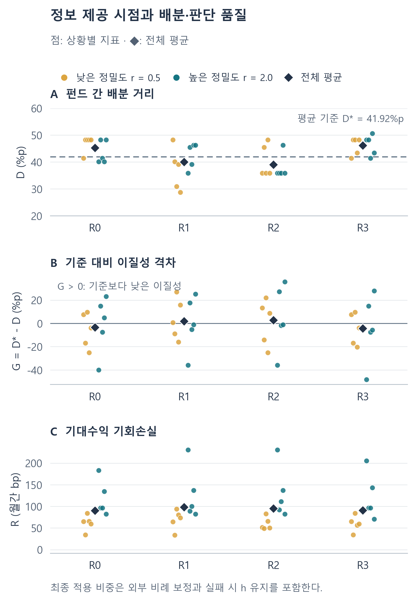
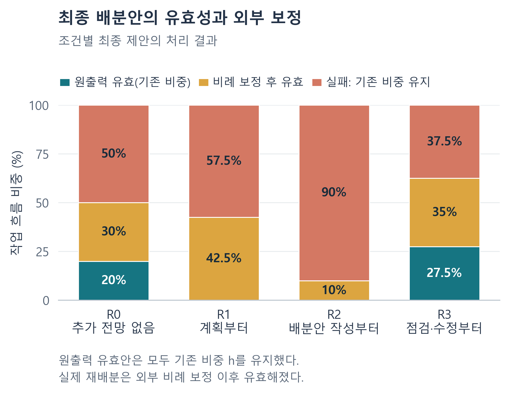

# 공통 GenAI는 기관투자자의 전략적 이질성을 축소하는가?

**액티브 주식형 펀드의 자산배분 프로세스 내 Workflow RAG 배치와 완화효과를 중심으로**

LIBERA · 2026년 10월 30일 · 본실험·결과해석·해결방안 통합 최종본

## 국문초록

본 연구는 공통 생성형 AI(GenAI)가 기관투자자의 전략적 이질성을 축소하는지 분석하고, 액티브 주식형 펀드의 자산배분 과정에 배치한 Workflow RAG의 완화효과를 검토한다. 기관들이 동일한 투자 규칙을 채택하지 않아도 검색·요약·전망 분석에서 공통 모델의 해석에 의존하면서, 운용조건에 따라 필요한 판단 차이가 약화될 수 있다는 문제에서 출발한다.

미국 액티브 주식형 펀드 네 개의 공개 보유자료와 산업별 위험척도로 통제 과제를 구성하였다. 열 개의 합성 전망 상황에서 추가 근거 미제공과 계획·배분안 작성·점검 단계부터의 제공을 비교하였다. 총 160개 업무 흐름을 펀드별 정보와 제약에 따른 수리 기준배분과 대조하고, 과잉수렴·차이의 정합성·모형상 기대수익 손실·유효성을 평가하였다.

계획·작성 단계 제공에서는 기준보다 펀드 간 차이가 각각 평균 1.92%p와 2.85%p 작았고, 미제공·점검 단계 제공에서는 차이가 컸다. 점검 단계 제공의 유효율은 62.5%로 가장 높았지만 평균 기대수익 손실은 미제공 조건보다 낮아지지 않았다. 실패 후 기존 보유 유지와 외부 정규화도 관측된 이질성의 형성에 관여하였다.

이 결과를 바탕으로 기관별 근거와 변경량을 연결하고, 허용 정보의 계산과 제약 검증을 필수화하며, 최종 점검에서 위반 항목을 지정하여 수정하는 Workflow RAG를 제안한다. 해결의 목표는 기관별 정보와 운용조건이 뒷받침하는 차이를 최종 선택에 보존하는 것이다. 보완 절차의 완화효과는 같은 평가 기준의 후속 비교에서 검증하도록 설계하였다.

**주제어:** 생성형 AI, 기관투자자, 전략적 이질성, 과잉수렴, 자산배분, Workflow RAG

## 1. 문제 제기

생성형 인공지능(Generative AI, 이하 GenAI)의 확산은 사회와 경제에서 정보를 생산하고 판단하는 방식을 바꾸고 있다. 사람들은 AI를 통해 자료를 찾고 문서를 작성하며, 업무에 필요한 분석과 대안을 마련한다. 이러한 변화는 AI의 업무 효용에 대한 기대와 일정 수준의 신뢰를 바탕으로 일상적인 사용으로 이어지고 있다. 멜버른대학교와 KPMG의 2025년 국제조사에서 응답 근로자의 58%는 업무에서 수개월에 한 번 이상 AI를 의도적으로 사용했고, 53%는 업무 목적으로 AI를 신뢰할 의향이 있다고 답했다.[^intro1] 이제 AI로 달라지는 사회를 이해하려면 사용의 확산과 함께, AI에 의존하는 판단이 어떤 조건에서 적절하게 이루어지는지 살펴야 한다.

그러나 자료를 빠르게 정리하고 설득력 있는 설명을 만드는 능력이 미래의 결과를 정확하게 예측하고 적절한 선택을 내리는 능력까지 보장하지는 않는다. Dell’Acqua 등(2026)은 같은 지식업무 흐름 안에서도 과제에 따라 AI 지원이 성과를 높이거나 오히려 낮출 수 있음을 보였다.[^intro2] 이처럼 과제별 성능이 고르지 않다는 점은 미래 예측을 수반하는 전략적 의사결정에서 특히 검토할 필요가 있다. 전략적 판단은 불확실한 전망을 해석하는 데 더해, 의사결정자마다 다른 목표와 자원, 허용 위험에 맞추어 행동을 선택하는 과정이기 때문이다. 따라서 AI가 제시하는 전망의 타당성과 그 전망을 각 주체의 조건에 맞는 선택으로 연결하는 능력을 함께 평가해야 한다.

본 연구는 이러한 전략적 의사결정 가운데 자산운용사의 액티브 주식형 펀드 투자판단에 주목한다. 펀드는 여러 투자자가 맡긴 자금을 운용하며, 개별 펀드의 투자목표와 전략, 현재 보유자산 및 위험 여력에 따라 자산 구성을 조정한다. 같은 산업의 전망이 개선되어도 해당 산업을 이미 많이 보유한 펀드와 적게 보유한 펀드에 적절한 조정은 다를 수 있다. 펀드를 선택한 이유는 이처럼 공통된 시장 전망과 펀드별로 다른 운용조건이 하나의 배분 판단에 함께 작용하기 때문이다. 또한 미국 등록 펀드는 투자설명서와 보유자산 공시를 통해 목표·전략·위험과 출발 포트폴리오를 확인할 수 있어, 조건의 차이가 배분 차이로 이어지는지를 비교할 자료를 확보할 수 있다.[^intro3] 액티브 펀드는 기관별로 필요한 판단 차이와 그 차이의 적절성을 함께 살필 수 있는 분석 단위다.

금융권에서 AI가 판단에 관여하는 경로는 최종 투자결정의 완전한 자동화에 한정되지 않는다. 영국은행과 금융행위감독청(FCA)의 2024년 조사에서는 응답 금융회사 118곳 중 75%가 AI를 사용했지만, 보고된 AI 활용사례 가운데 완전자율 의사결정의 비중은 2%였다. Morgan Stanley의 AskResearchGPT도 자체 리서치의 검색과 종합을 지원하는 사례다.[^intro4] 자료 검색, 핵심 위험의 요약, 전망 해석과 배분안 초안 작성처럼 개별 업무에 GenAI가 분산적으로 결합하면, 인간이 최종 승인하는 체계에서도 AI의 산출물이 판단의 출발점을 형성할 수 있다.

업무 성과를 높이려는 실무자는 이용 가능한 GenAI 가운데 해당 시점에 업무 성능이 가장 우수하다고 판단하는 모델을 선택할 유인이 있다. 이러한 평가가 여러 실무자와 기관에서 겹치면, 서로 독립적으로 도구를 선택하더라도 동일한 모델로 선택이 집중될 수 있다. 본 연구는 이러한 선택의 집중 가능성을 출발 가정으로 삼아, 동일한 모델을 활용할 때 기관별 정보와 운용조건에 근거한 판단 차이가 유지되는지 살핀다.[^intro5]

선택의 집중이 나타나는 경우, 공통 모델은 여러 기관의 업무 안에서 숨은 판단 계층으로 작동할 수 있다. 모델이 어떤 정보를 중요하게 요약하고 어떤 대안과 위험을 검토 대상으로 제시하는지가 이후 분석과 배분안 작성의 입력이 되기 때문이다. 각 기관이 명시적으로 같은 투자 규칙을 채택하지 않아도, 공통 모델의 정보 선택과 해석 방식이 중간산출물을 통해 다음 단계로 전달되고 누적될 수 있다. 본 연구는 이러한 분산적 사용이 펀드별 조건에서 요구되는 판단 차이를 최종 배분까지 유지하는지 묻는다.

이때 여러 펀드의 배분이 비슷하다는 사실만으로 문제라고 볼 수는 없다. 공통 정보와 유사한 제약이 같은 선택을 지지한다면 수렴은 합리적일 수 있다. 본 연구가 보존하려는 전략적 이질성은 펀드별 정보와 운용조건에 근거한 판단 차이다. 이에 각 펀드의 정보와 제약 아래 계산한 기준배분보다 펀드 간 배분 차이가 작은 상태를 과잉수렴으로 정의한다. 과잉수렴이 기준배분 대비 기대수익 손실이나 투자제약 위반과 같은 품질 저하를 동반할 때에는 부정적 동질화의 문제로 해석한다. 공유 모델의 사용, 결과의 유사성, 개별 판단의 품질을 구분한 선행연구도 이러한 공동 평가의 필요성을 뒷받침한다.[^intro6]

이 문제는 개별 펀드의 판단을 넘어 시장 차원으로 확장될 가능성이 있다. 유사한 권고가 실제 포지션 조정과 거래로 이어지면 가격과 유동성이 바뀌고, 변화한 시장자료가 다음 시점의 AI 분석에 다시 입력될 수 있다. 금융안정위원회(FSB)가 지적한 공통 모델·데이터 의존에 따른 시장 상관성의 위험과, 예측에 따른 행동이 이후의 데이터 생성환경을 바꾸는 예측의 수행적 피드백(performative feedback)은 이러한 확장경로를 설명한다.[^intro7] 본 연구는 이 경로 중 실제 거래 이전의 배분 판단을 검증 범위로 삼는다.

대응방안으로는 펀드별 근거를 투자판단의 업무 단계에 연결하는 Workflow RAG를 검토한다. 검색증강생성(Retrieval-Augmented Generation, RAG)은 검색된 외부 자료를 생성 과정에 결합하는 접근으로, 공통 모델에 기관 고유의 정보와 운용조건을 연결할 수 있다.[^intro8] 다만 근거를 제공했다는 사실만으로 필요한 판단 차이가 회복된다고 가정할 수는 없다. 초기 계획에서 형성된 해석이 이후 단계에 남을 수 있으므로, 같은 근거를 어느 단계부터 제공하고 유지하는지가 최종 배분에 미치는 영향을 확인해야 한다. 본고는 계획, 배분안 작성, 점검·수정 단계부터의 근거 제공을 비교하고, 과잉수렴의 완화와 판단 품질의 개선이 함께 나타나는지를 평가한다.

이를 위해 미국 액티브 주식형 펀드 네 개의 공개 보유자료에 공통 전망과 펀드별 합성 전망을 결합한 통제 과제를 구성하고, 근거 미제공 및 세 단계별 제공의 네 조건에서 총 160개 업무 흐름을 수행하였다. 실험에서는 전망을 입력으로 주고, 그 정보와 펀드별 위험조건이 산업배분에 얼마나 적절하게 반영되는지를 수리 기준배분과 대조하였다. 계획·작성 단계 제공에서는 평균 과잉수렴이 나타났고, 점검 단계 제공에서는 배분 차이가 확대되었으나 기대수익 손실의 개선은 확인되지 않았다. 본고는 이러한 결과를 바탕으로 기관별 근거와 배분 변경의 연결, 계산과 제약 검증, 위반 항목별 수정을 결합하는 Workflow RAG를 제안한다. 연구의 기여는 금융권의 분산적 GenAI 활용이 필요한 판단 차이를 약화시킬 수 있다는 문제를 검증 가능한 배분 과제로 구체화하고, 차이의 보존과 판단 품질을 함께 고려한 완화 절차의 설계 방향을 제시하는 데 있다. 보완 절차의 효과와 실제 거래·시장피드백으로의 확장은 후속 검증 과제로 남긴다.

[^intro1]: Gillespie 등(2025), Trust, Attitudes and Use of Artificial Intelligence: A Global Study 2025, 본문 pp.71–73, 그림 42–43. 전체 조사는 47개국 48,340명이며 두 비율은 근로자 하위표본의 응답이다. 사용은 ‘수개월에 한 번’부터 ‘매일’까지, 신뢰는 업무에서 AI에 의존하거나 관련 정보를 제공할 의향을 뜻한다. 생성형 AI만의 사용률이나 예측 정확도를 측정한 수치는 아니다. [보고서](https://kpmg.com/content/dam/kpmgsites/xx/pdf/2025/05/trust-attitudes-and-use-of-ai-global-report.pdf.coredownload.inline.pdf)

[^intro2]: Dell’Acqua 등(2026), Navigating the Jagged Technological Frontier, Organization Science, 37(2), 403–423. 컨설턴트 대상 실험에서 과제별로 달라지는 AI 지원의 성과를 분석하였다. 펀드의 미래 수익률 예측능력을 직접 검증한 연구는 아니며, 본문은 과제에 따른 성능 차이를 전략적 판단의 평가 필요성과 연결한 것이다. [원문](https://doi.org/10.1287/orsc.2025.21838)

[^intro3]: U.S. SEC(2016), How to Read a Mutual Fund Prospectus, Part 1; U.S. SEC(n.d.), Form N-PORT Data Sets. 전자는 투자목표·전략·위험의 공시 항목을, 후자는 등록 운용회사의 포트폴리오 자료를 설명한다. 실제 분석의 펀드별 자료 추출·대조 경로는 부록 A에 제시하였다. [투자설명서 안내](https://www.investor.gov/introduction-investing/general-resources/news-alerts/alerts-bulletins/investor-bulletins/how-read-2) · [N-PORT 자료 설명](https://www.sec.gov/data-research/sec-markets-data/form-n-port-data-sets)

[^intro4]: Bank of England·FCA(2024), Artificial Intelligence in UK Financial Services – 2024, §1.2·§2.1·§2.5; Morgan Stanley(2024), AskResearchGPT 발표. 75%의 분모는 응답 회사, 2%의 분모는 AI 활용사례이며 금융회사 조사는 AI 전반을 다룬다. 분산 사용의 보조 근거로 Microsoft·LinkedIn(2024)의 31개국 지식근로자 31,000명 조사에서는 GenAI 사용자 중 78%가 개인이 선택한 도구를 업무에 가져왔다. 이 수치를 금융권 사용률로 일반화하지 않는다. [금융회사 조사](https://www.bankofengland.co.uk/report/2024/artificial-intelligence-in-uk-financial-services-2024) · [기업 발표](https://www.morganstanley.com/press-releases/morgan-stanley-research-announces-askresearchgpt) · [업무 활용 조사](https://www.microsoft.com/en-us/worklab/work-trend-index/ai-at-work-is-here-now-comes-the-hard-part/)

[^intro5]: FSB(2024), The Financial Stability Implications of Artificial Intelligence, §4.2.2, 본문 pp.20–22는 성능 요건을 충족하는 선택지의 제한, 공급자 집중과 공통 모델·데이터 의존을 논의한다. 성능 평가가 겹쳐 같은 모델로 선택이 집중된다는 경로는 본 연구의 출발 가정이다. 본실험은 실제 도구 선택의 집중도나 성능이 가장 우수한 모델을 식별하는 실험이 아니다. [보고서](https://www.fsb.org/uploads/P14112024.pdf)

[^intro6]: Bommasani 등(2022), Picking on the Same Person; Doshi·Hauser(2024), Generative AI enhances individual creativity but reduces the collective diversity of novel content. 각각 공유 모델과 결과 동질화의 조건부 관계, 개별 산출물 평가와 집단 다양성의 차이를 다룬다. 과잉수렴과 부정적 동질화의 정의 및 금융 과제의 평가 방식은 본 연구의 분석 틀이다. [공유 모델 연구](https://proceedings.neurips.cc/paper_files/paper/2022/hash/17a234c91f746d9625a75cf8a8731ee2-Abstract-Conference.html) · [창작 실험](https://discovery.ucl.ac.uk/id/eprint/10195027/)

[^intro7]: FSB(2024), 앞의 보고서, §4.2.2, 본문 pp.20–22; Perdomo 등(2020), Performative Prediction, PMLR 119, 7599–7609. 전자는 금융시장의 공통 모델 의존과 상관성 위험을, 후자는 예측에 따른 행동이 데이터 생성환경을 바꾸는 구조를 설명한다. 실제 시장효과가 본실험에서 관측되었다는 뜻은 아니다. [금융안정 보고서](https://www.fsb.org/uploads/P14112024.pdf) · [피드백의 이론적 근거](https://proceedings.mlr.press/v119/perdomo20a.html)

[^intro8]: Lewis 등(2020), Retrieval-Augmented Generation for Knowledge-Intensive NLP Tasks, NeurIPS 33, 9459–9474. 외부 검색과 생성을 결합하는 RAG의 원 논문이다. 계획·작성·점검에 근거를 배치하는 방식과 금융 과제에서의 완화효과는 본 연구의 검증 대상이다. [원문](https://proceedings.neurips.cc/paper/2020/hash/6b493230205f780e1bc26945df7481e5-Abstract.html)

## 2. 선행연구와 분석 틀

### 2.1 공통 모델과 전략적 이질성

공통 도구의 사용은 개별 산출물의 품질과 여러 산출물 사이의 관계를 동시에 바꾼다. Doshi와 Hauser(2024)는 이야기 작성 실험에서 생성형 AI의 지원이 개별 산출물의 평가를 높이면서 집단 수준의 다양성을 낮출 수 있음을 보고하였다. Bommasani 등(2022)은 공유 모델의 사용과 실제 결과의 동질화 사이의 관계가 조건에 따라 달라짐을 보였다. 두 연구를 금융 과제에 적용할 때 가져올 관점은 개별 판단의 적절성과 집단적 차이를 별도로 측정하는 것이다.

금융에서는 차이의 크기에 운용조건의 정합성이 더해진다. 서로 다른 펀드의 보유상태, 위험상한과 전망은 서로 다른 최적 선택을 지지할 수 있다. 본고는 이 조건부 기준배분의 펀드 간 거리를 필요한 차이의 비교 기준으로 사용한다. 실제 배분의 거리가 기준보다 작은지, 차이를 만든 산업이 기준과 일치하는지, 기대수익 손실이 줄었는지를 함께 확인하여 전략적 이질성의 보존을 평가한다.

금융 AI 연구도 정보 구조와 행동의 관계를 구분한다. Hansen과 Lee(2025)는 통제된 투자 군집행동 과제에서 정보와 지시에 따른 AI의 반응을 분석하였다. Anand 등(2026)은 모의 펀드 환매게임에서 AI의 구조와 정보 분배가 조정에 관여하는 양상을 검토하였다. 후자의 과제는 본고의 산업배분과 다르지만, 서로 다른 정보의 제공만으로 행동의 차별화가 보장되지 않는다는 질문을 공유한다. 이에 본 연구는 동일한 모델 안에서 근거 제공 절차와 최종 배분의 관계를 구체적으로 측정한다.

### 2.2 금융 정보와 Workflow RAG의 배치

Hornuf 등(2025)은 포트폴리오 배분 과제에서 제공 정보를 통제하여 추가 정보의 역할을 비교하였다. 추가 정보, 위험과 배분 품질을 구분한 이 연구는 기관별 자료의 효과를 복수의 지표로 평가할 필요성을 뒷받침한다. 본고에서는 필요한 펀드 간 차이와 개별 배분의 품질을 공동 성과로 두고, 같은 근거의 최초 제공 단계에 따라 두 성과가 어떻게 달라지는지 살핀다.

RAG의 기본 기능은 외부 근거를 검색하여 생성에 연결하는 것이다(Lewis 등, 2020). 본 연구의 Workflow RAG는 이 연결을 계획·작성·점검의 업무 흐름에 배치한다. 검색 패킷을 동일하게 유지하면 단계별 비교에서 근거 내용의 차이를 줄일 수 있다. 다만 조기 제공과 후기 제공은 근거를 받은 시점뿐 아니라 그 근거에 노출된 횟수, 앞선 계획과 대화 이력도 함께 바꾼다. 따라서 본고의 비교 대상은 각 시점부터 근거를 제공하고 이후 유지하는 절차 전체다.

Laban 등(2025)은 여러 대화에 나누어 정보를 제공하는 상황에서 초기 가정과 누적된 응답이 후속 판단에 남는 문제를 다루었다. 자산배분에서도 앞선 계획과 초안은 이후 수정의 출발점이 된다. 본고는 자료를 어느 단계부터 연결하는지가 전략 차이에 미치는 양상을 비교하고, 점검 과정에서 실제 배분이 바뀌었는지도 함께 확인한다. 이를 통해 검색의 완료와 필요한 차이의 회복 사이에 존재하는 업무상 연결을 평가한다.

### 2.3 완화효과의 평가와 해결방안의 근거

Workflow RAG의 완화효과는 펀드별 근거가 필요한 차이를 회복하면서 판단 품질을 유지하는가로 평가한다. 평균 배분 거리가 커졌더라도 산업별 차이의 방향과 기대수익이 기준에서 멀어지면 전략 보존의 성과는 제한된다. 반대로 기존 보유를 유지하여 기관 간 차이가 남았을 때에는 새 정보가 반영된 결과인지, 실패에 대한 보류 정책이 만든 결과인지 구분해야 한다. 본고는 과잉수렴, 차이의 정합성, 기대수익 손실과 배분 유효성을 함께 분석한다.

설명과 실제 정보 반응을 대조하는 연구는 이 평가를 보완한다. Matton 등(2025)은 설명에서 중요하게 다룬 개념과 입력 개입에 실제로 반응하는 개념 사이의 대응을 분석하였다. 본 연구에서는 제공된 근거, 제출 비중과 처리 결과를 대조하고, 근거를 바꾸는 개입 검사는 후속 검증으로 설계한다. 근거를 설명에 적은 것과 그 근거에 맞는 전략 차이를 만든 것을 구분하는 관점이다.

해결 절차에는 계산과 검증을 분담하는 문헌을 참고한다. Gao 등(2023)의 PAL은 언어모델의 해석과 외부 프로그램의 계산을 결합하였고, Gou 등(2024)의 CRITIC은 외부 도구의 검증 결과를 수정에 연결하였다. 본고는 이 구조를 기관별 근거와 배분 변경의 연결, 고정 계산 함수와 위반 항목별 수정에 적용한다. 금융배분에서의 완화효과는 본실험의 관측과 구분하여 후속 비교로 평가한다.

## 3. 실험설계

### 3.1 연구질문과 비교 논리

본실험은 공통 GenAI 아래 나타나는 전략적 이질성과 Workflow RAG 배치의 완화효과를 세 질문으로 나누어 평가한다.

**RQ1. 공통 모델이 생성한 펀드 간 배분 차이는 각 펀드의 정보와 제약에 따른 기준보다 축소되는가?** 실제 거리와 기준 거리의 차이로 과잉수렴을 측정하고, 평균에서 상쇄되는 오차를 함께 확인한다.

**RQ2. 기관별 근거를 연결한 Workflow RAG는 필요한 차이의 정합성과 판단 품질을 함께 개선하는가?** 근거 미제공 조건과 제공 조건의 과잉수렴, 산업별 차이 방향과 기대수익 손실을 비교한다.

**RQ3. 계획·배분안 작성·점검 중 어느 단계부터 근거를 배치할 때 완화효과가 나타나며, 그 결과는 어떤 배분 과정에서 형성되는가?** 단계별 제공 조건의 공동 성과를 비교하고, 유효성·외부 정규화·기존 보유 유지와 수정 과정을 분석한다.

동일한 시장 상황에 놓인 네 펀드를 비교 단위로 사용하였다. 상황과 펀드의 출발 조건은 자료 조건 간에 고정하고, 펀드별 추가 전망의 최초 제공 단계만 달리하였다. 전망 정밀도별 다섯 개씩 열 개의 합성 상황에 네 펀드와 네 자료 조건을 적용하여 총 160개 업무 흐름을 수행하였다. 각 흐름은 계획, 배분안 작성, 점검·수정의 세 단계이며 조건별 반복은 한 번이다. 결과는 상황별 평균에 같은 비중을 부여하여 집계하였다.

### 3.2 실제 펀드 자료와 산업배분 과제

펀드의 출발 상태는 2025년 말 공개 보유자료를 기준으로 구성하였다. 공개일 마감은 2026년 3월 말로 두고, 보유종목을 Fama–French 12개 산업에 연결하였다. 분류 가능한 주식 부문의 평가액을 합계 1로 정규화한 비중을 h로 정의하였다. 따라서 과제의 대상은 각 펀드의 분류 가능한 주식 부문이며, 현금·채권 등을 포함한 펀드 전체 자산배분과는 구분된다.

**표 1. 분석 대상과 출발 비중의 구성**

| ID | 펀드 | 티커 | 분류 대상 적격주식의 FF12 포괄률 | 분류된 주식 부문 / 순자산 |
| --- | --- | --- | --- | --- |
| F01 | Fidelity Contrafund | FCNTX | 94.72% | 90.56% |
| F02 | Vanguard PRIMECAP Fund | VPMCX | 96.35% | 95.46% |
| F03 | Dodge & Cox Stock Fund | DODGX | 97.75% | 97.01% |
| F04 | T. Rowe Price Blue Chip Growth Fund | TRBCX | 99.29% | 98.04% |

주: 보유 기준일은 2025-12-31, 공개일 마감은 2026-03-31이다. h의 분모는 산업 분류가 완료된 주식 부문 평가액이다. 포괄률의 분모는 분류 대상 적격주식의 전체 평가액이며, 오른쪽 열의 분모는 순자산이다.

통제 과제의 목적은 허용된 전망에 따른 월간 사후 기대수익의 극대화다. 모델은 산업별 목표비중과 기존 보유비중 대비 변경을 제시한다. 수치 제약은 모든 목표비중의 비음수, 합계 1, 기존 주식 부문의 위험을 넘지 않는 분산 상한이다. 운용목표와 규정은 자료 맥락으로 제공했으며, 이번에 구성된 네 펀드의 FF12 추가 선형제약 행렬은 비어 있다. 따라서 본고의 ‘유효 배분’은 위의 세 수치 조건을 만족하는 배분을 뜻한다. 발행사별·국가별 규정과 펀드 전체의 규제 준수는 이 산업배분 검사와 별개의 평가 대상이다.

### 3.3 공통 전망, 펀드별 전망과 수리 기준배분

위험척도는 French의 산업 포트폴리오 자료에서 2016년 1월부터 2025년 12월까지의 FF12 가치가중 월간 총수익률로 추정하였다(French, n.d.). 월간 평균을 사전 기대수익으로 사용하고, Ledoit–Wolf 수축 공분산으로 산업 간 위험을 구성하였다(Ledoit와 Wolf, 2004). 실제 보유상태와 위험척도 위에 공통 전망과 펀드별 추가 전망을 합성하여, 정보가 배분에 미치는 영향을 계산 가능한 과제로 만들었다. 합성 전망은 실제 펀드 운용자의 내부 전망을 대신하는 실험 입력이다.

펀드별 전망의 정밀도 r은 오차 공분산을 V₀/r로 설정한다. r=2인 전망은 r=0.5보다 오차 공분산이 작다. 이 정밀도는 실현 수익률의 적중률과 다른 모형 매개변수다. 원래 생성한 상황 중 각 정밀도 수준의 앞선 다섯 ID를 결과 확인 이전에 선택하였고, 기존 생성값과 실행 순서를 유지하였다. 정밀도별 상황은 서로 다른 추출값을 사용하므로 수준 간 결과는 해당 상황군의 관측으로 해석한다.

평가자는 각 펀드의 허용 정보에 따른 사후 기대수익을 계산하고 동일한 제약 아래 기준배분을 구하였다. 모델에는 이 최적 배분을 제공하지 않았다. 주된 비교는 공통 전망과 해당 펀드의 전체 추가 전망을 사용한 기준배분이며, R0에는 실제로 제공된 공통 정보만 사용한 기준도 보조적으로 계산하였다. 여기서 전체정보 기준은 평가용 수리해를 의미한다. 전체 원문을 제공하는 별도 모델 조건은 본실험에 포함하지 않았다.

### 3.4 Workflow RAG의 단계별 배치

검색에는 고정된 BM25 설정을 사용해 각 펀드·상황의 자료에서 상위 문서 조각 네 개를 선택하였다. R1, R2와 R3에는 동일한 검색 패킷을 전달하였다. 모든 패킷에 해당 펀드의 산업별 전망값 열두 항목이 포함됨을 입력 기록에서 확인하였다. 본실험에서 비교하는 것은 이 근거를 업무 흐름에 처음 연결하는 단계다.

**표 2. 단계별 자료 제공 조건**

| 조건 | 1단계: 계획 | 2단계: 배분안 작성 | 3단계: 점검·수정 |
| --- | --- | --- | --- |
| R0 | 공통 정보 | 공통 정보와 이전 응답 | 공통 정보와 이전 응답·검사 결과 |
| R1 | 펀드별 검색 근거 추가 | 근거와 이전 응답 유지 | 근거·이전 응답·검사 결과 유지 |
| R2 | 공통 정보 | 펀드별 검색 근거 추가 | 근거·이전 응답·검사 결과 유지 |
| R3 | 공통 정보 | 공통 정보와 이전 응답 | 펀드별 검색 근거 추가 및 검사 결과 제공 |

계획 단계에서는 사용할 근거와 산업별 판단 방향을 정하고, 작성 단계에서는 목표비중과 변경량을 제출한다. 이어 외부 코드가 원비중과 정규화 결과의 제약 충족 여부를 검사하여 점검 단계에 전달한다. 점검 단계는 이전 배분과 검사 결과를 참고해 최종안을 제출한다. 각 단계의 이전 대화는 모두 유지하며, 다른 조건에서 생성한 답변을 복사해 초기안으로 사용하지 않았다.

모델에는 사후 기대수익을 계산하는 도구와 제안 비중의 제약을 검사하는 도구를 제공하였다. 사용은 선택 사항이고 단계별 추가 왕복은 최대 두 번이다. 도구가 허용하는 정보는 해당 단계까지 제공된 근거로 한정하였다. 모델 스스로 계산도구를 사용하는 과정과, 외부 코드가 정해진 위치에서 수행하는 검사·정규화는 실행 기록에서 구분하였다.

### 3.5 최종 수행 범위와 설계 조정

최종 수행은 B-main의 R0–R3 조건으로 확정하였다. 전체 적격 원문을 제공하는 FULL/C-context 조건은 제외했고, 실제자료·검색 범위의 별도 모듈, 전망 교체와 음성대조도 이번 실행에 포함하지 않았다. FULL의 제외는 정보 조건의 축소이며, 계획→배분안 작성→점검·수정의 세 단계는 유지하였다. 펀드별 전체 추가 전망을 사용하는 수리 기준배분은 평가자로 남겨 필요한 차이와 기대수익 손실을 계산하였다.

상황은 r=0.5와 r=2에서 각각 앞선 다섯 ID를 결과 확인 전에 선정하고 기존 생성값과 실행 순서를 유지하였다. 최종 범위는 열 상황·네 펀드·네 조건·반복 한 번이다. 기존 원고의 공개전망 다섯 조건과 과거 개발 응답은 이번 본실험의 표본에 합산하지 않았다. 결과 분석도 이 완료 범위에 맞춘 탐색적 기술분석으로 구성하였다.

이 설계는 공통 모델을 사용한 상태에서 필요한 배분 차이가 보존되는지, Workflow RAG의 배치에 따라 어떻게 달라지는지를 비교한다. 실제 펀드의 출발 상태 위에 합성 전망을 사용하여 정보와 제약의 기준을 계산 가능하게 만든 통제 과제다. 운용자의 실제 비공개 전망과 거래행동, 실현 수익률은 별도로 관측할 대상이다.

## 4. 실험과정과 평가방법

### 4.1 준비, 실행과 중단·재개

먼저 펀드별 보유상태와 위험척도를 확정하고, 선정된 상황의 공통·추가 전망, 검색 패킷과 기준배분을 준비하였다. 검색은 BM25로 상위 네 조각을 선택했으며, 모든 펀드·상황 패킷에 산업별 추가 전망 열두 항목이 포함됨을 확인하였다. 이어 고정된 실행 순서로 각 조건의 세 단계를 수행하고, 원응답과 비중 처리 결과를 같은 실행 식별자 아래 저장하였다.

모든 조건은 Qwen3:1.7b의 Q4_K_M 양자화 모델을 Ollama 0.35.1과 로컬 Intel Arc 140V/Vulkan 환경에서 사용하였다. 생성 설정은 temperature 0, seed 1001, thinking 비활성화이며, 문맥 한도는 32,768토큰, 단계 출력 한도는 4,096토큰이다. 모델은 근거의 해석, 계획과 목표비중·변경량을 생성하였다. 코드는 검색, 사후분포와 기준배분의 계산, 비중 검사·정규화 및 지표 집계를 수행하였다. 최적 배분은 모델에 제공하지 않았다.

본실험 응답 생성 전에 독립 수치 솔버의 수렴 문제를 수정하였다. 목적함수의 내부 스케일을 조정하고 위험제약이 비활성인 경우의 검증된 꼭짓점 해를 처리했으며, 목적과 원래 제약·허용오차는 유지하였다. 이후 실행 중 재부팅이 발생했을 때 완료 응답을 재사용하고, 응답이 저장되지 않은 요청은 같은 입력으로 재개하였다. 잘못된 답변을 성공할 때까지 다시 생성하는 방식은 사용하지 않았다.

실험은 2026년 10월 28일 11:01:58 KST에 시작해 10월 29일 14:28:41 KST에 최종 분석을 마쳤다. 중단을 포함한 전체 경과시간은 27시간 26분 43초다. 160개 업무 흐름과 480개 단계 응답을 확보했으며, 최종 집계의 미해결 운영 실패·프로토콜 위반·복구 차단은 없었다. 모델이 수치 제약을 만족했는지는 별도의 실험 결과로 평가하였다. 전송·복구와 요청별 비용의 상세 기록은 부록 A에 정리하였다.

### 4.2 원출력, 외부 정규화와 최종 적용 비중

모델이 제시한 원비중 u와 원문을 보존하고, 원출력의 제약 충족 여부를 먼저 검사하였다. 원출력부터 제약을 충족한 경우는 원출력 유효로 분류하였다. 외부 정규화는 유한한 비음수 성분 열두 개로 이루어지고 합계가 양수인 벡터에만 적용하였다. 각 성분을 원합계로 나눈 뒤 합계의 부동소수점 잔차만 가장 큰 성분에 반영하고, 원래 위험상한과 제약을 다시 검사하였다.

원출력은 부적합했지만 정규화와 재검사를 통과한 경우는 정규화 구제로 분류하였다. 음수 목표비중 또는 정규화 후 제약 위반이 남은 경우는 실패로 기록하고 기존 보유비중 h를 적용하였다. 음수를 0으로 자르거나 부호를 뒤집어 구제하지 않았다. 합계 조정은 모델의 원응답을 바꾸는 대신 별도의 처리 기록으로 저장하였다.

```math
w = u / Σₖuₖ   (정규화 자격을 갖추고 원래 제약을 충족한 경우)
w = h          (최종 제안이 처리 규칙을 통과하지 못한 경우)
```

최종 적용 비중 w는 모델 제안, 외부 정규화와 기존 보유 유지 정책이 결합된 결과다. 실패를 제외하지 않고 이 결과 전체에서 전략적 이질성을 평가한 뒤, 원출력 유효·정규화 구제·실패의 기여를 나누었다. 유효한 제안이 h를 실제로 바꾸었는지도 확인하여 제약 충족과 재배분을 구분하였다. 비중 검사의 허용오차와 동일성 기준은 부록 B에 제시하였다.

### 4.3 필요한 차이와 과잉수렴

펀드 간 배분 거리는 총변동거리(TV)로 계산한다. 두 배분의 산업별 절대 차이를 합한 뒤 절반으로 나눈 값으로, 전체 비중 중 서로 다르게 배치된 부분의 크기를 나타낸다. 펀드 i와 j의 적용 비중을 wᵢ, wⱼ, 기준배분을 vᵢ, vⱼ라고 하면 다음과 같다.

```math
Dᵢⱼ = ½ Σₖ |wᵢₖ − wⱼₖ|,     D*ᵢⱼ = ½ Σₖ |vᵢₖ − vⱼₖ|
Gᵢⱼ = D*ᵢⱼ − Dᵢⱼ
```

G가 양수이면 기준보다 펀드 간 차이가 작고, 음수이면 더 크다. 각 상황에서 펀드 비교쌍을 평균한 뒤 상황별 평균을 같은 비중으로 합산하였다. 본문의 거리 수치는 비중의 차이를 쉽게 읽도록 100을 곱한 %p 단위로 보고한다. 비교쌍과 단계 응답을 별도의 독립 표본으로 계산하지 않았다.

### 4.4 차이의 정합성과 기대수익 손실

평균 G만으로는 서로 다른 방향의 오차가 상쇄될 수 있다. 이를 보완하기 위해 비교쌍별 거리 오차 A와 차이 방향의 불일치 E를 계산하였다. A는 실제 거리와 기준 거리의 절대 차이이며, E는 두 펀드 사이 산업별 비중 차이의 벡터가 기준의 벡터에서 벗어난 정도다. 거리가 같더라도 서로 다른 산업을 구분했다면 E는 크게 나타날 수 있다.

```math
Aᵢⱼ = |D*ᵢⱼ − Dᵢⱼ|
Eᵢⱼ = ½ Σₖ |(wᵢₖ − wⱼₖ) − (vᵢₖ − vⱼₖ)|
Rᵢ = μᵢᵀ (vᵢ − wᵢ)
```

R은 동일한 정보와 제약 아래 기준배분에 비해 포기한 월간 사후 기대수익이다. 본문에서는 1bp=0.01%p로 환산한다. 이 값은 합성 전망을 사용하는 모형상 기회비용이며 실현 투자수익률과 구분된다. 해석을 돕기 위해 모든 펀드가 기존 h를 그대로 유지했을 때의 같은 지표도 계산하였다. 이는 저장된 입력으로 산출한 비교 기준으로 별도 모델 실행을 추가하지 않는다.

### 4.5 배분의 형성 경로와 수정 과정의 진단

실패는 음수 목표비중, 정규화 후 위험상한 위반 등 실제 발생 위치에 따라 구분하였다. 원비중이 h 또는 −h와 같은지, 작성 단계에서 점검 단계로 가며 유효성과 적용 비중이 달라졌는지도 확인하였다. 계산도구는 설명의 표현과 실제 호출 기록을 구분해 집계하였다. 이 진단은 실패가 최종 적용 비중과 이질성 지표에 어떻게 연결됐는지를 설명한다.

수리 기준배분의 가까운 최적해 사이에서 발생할 수 있는 차이는 별도 수치 범위로 확인하였다. 이 범위는 최적화 기준의 수치적 모호성을 다루며 표본의 신뢰구간으로 사용하지 않는다. 최종 분석에 쓰인 입력과 응답의 해시, 정규화 결과와 상황별 지표는 저장된 기록을 바탕으로 재검산하였다.

## 5. 실험 결과

결과는 전략적 이질성과 Workflow RAG의 완화효과를 먼저 보고하고, 그 결과가 어떤 배분 과정에서 형성됐는지 분석하는 순서로 제시한다. 네 조건의 비교는 실패 시 기존 보유를 적용한 결과까지 포함하며, 같은 전체정보 기준배분으로 평가하였다.

### 5.1 전략적 이질성의 축소와 확대

계획·작성 단계의 근거 제공은 평균적으로 기준보다 작은 펀드 간 배분 거리와 함께 나타났다. R1과 R2의 과잉수렴 격차는 각각 1.92%p와 2.85%p였다. 미제공 R0와 점검 단계 제공 R3에서는 실제 거리가 기준보다 컸다. R3는 네 조건 중 가장 큰 평균 배분 거리를 보였다.

**표 3. 전체정보 기준배분 대비 배분 차이와 판단 손실**

| 평가 지표 | R0 미제공 | R1 계획 | R2 배분안 | R3 점검 |
| --- | --- | --- | --- | --- |
| 펀드 간 배분 거리 D (%p) | 45.26 | 40.00 | 39.07 | 46.15 |
| 기준배분 거리 D* (%p) | 41.92 | 41.92 | 41.92 | 41.92 |
| 과잉수렴 격차 G (%p) | -3.34 | 1.92 | 2.85 | -4.23 |
| 거리 오차 A (%p) | 28.10 | 26.44 | 25.46 | 29.48 |
| 차이 방향의 불일치 E (%p) | 70.25 | 68.09 | 67.95 | 70.11 |
| 월간 기대수익 손실 R (bp) | 90.16 | 98.37 | 95.28 | 91.20 |

주: 모든 지표는 실패 시 h를 적용한 결과까지 포함한다. G=D*−D이며 양수는 기준 대비 차이의 축소를 뜻한다. A는 비교쌍별 절대 거리 오차의 평균으로 평균 G의 절댓값과 다르다. E는 산업별 차이 벡터의 불일치다. R은 모형상 월간 기대수익 손실이며 낮을수록 기준배분에 가깝다.



**그림 1. 펀드 간 차이와 기대수익 손실의 결합**

평균 수렴 격차에 비해 비교쌍별 거리 오차와 차이 방향의 불일치는 크게 남았다. 이는 서로 다른 상황과 펀드 쌍에서 차이의 축소와 확대가 상쇄되며 평균 G가 작아지는 구조를 보여준다. 예를 들어 R3의 평균 거리는 기준을 넘었지만 거리 오차와 방향 불일치는 함께 높았다. 필요한 이질성의 보존은 펀드 간 거리를 넓히는 것과 별도로 평가해야 한다.

이 패턴에는 실패 처리도 관여했다. R2는 대부분의 제안이 실패하여 기존 보유상태를 유지했고, 평균 과잉수렴 격차의 약 72.5%는 실패가 포함된 펀드 쌍의 기여에서 나왔다. 반면 R1에서는 정규화 구제 배분이 포함된 비실패 쌍의 수렴 기여와 실패 포함 쌍의 반대 방향 기여가 함께 나타났다. 같은 양의 G라도 그 배후에는 배분 변경과 기존 상태 유지라는 서로 다른 경로가 존재했다.

### 5.2 Workflow RAG 배치와 판단 품질

자료 제공 조건의 평균 기대수익 손실은 모두 R0보다 높았다. R3는 자료 제공 조건 중 가장 낮은 손실을 보였지만, 미제공 조건의 수준을 개선하지는 못했다. 또한 모든 조건의 평균 손실은 기존 보유비중을 그대로 유지하는 계산 기준보다 높았다. 이번 과제에서 추가 전망에 따른 변경은 평균적으로 기준배분의 기대수익에 더 가까워지는 성과로 이어지지 않았다.

**표 4. 기존 보유 유지와 비교한 모형상 기대수익 손실**

| 조건·계산 기준 | 월간 기대수익 손실 (bp) | 기존 보유 유지 대비 차이 (bp) |
| --- | --- | --- |
| 기존 보유비중 h 유지 | 87.84 | 0.00 |
| R0 | 90.16 | +2.32 |
| R1 | 98.37 | +10.53 |
| R2 | 95.28 | +7.44 |
| R3 | 91.20 | +3.36 |

주: 모든 행은 동일한 전체정보 사후 기대수익으로 평가한다. ‘기존 보유비중 h 유지’는 입력에 대한 수치 계산이며 별도 모델 조건이 아니다. 단위는 월간 bp다.

R0에는 정보 접근의 차이도 존재한다. 공통 정보만을 사용한 R0의 기준에서는 손실이 70.83bp였고, 펀드별 전망까지 사용하는 평가 기준에서는 90.16bp였다. 이 차이는 평가자가 사용하는 정보와 최적 배분이 달라질 때 생기는 기준의 차이다. R1–R3는 같은 펀드별 전망을 모두 제공받았으므로, 이 조건들의 손실은 정보를 전달받은 뒤의 배분 과정과 직접 연결해 볼 수 있다.

### 5.3 자료 제공 시점과 실제 재배분

자료를 최종 점검 단계에서 제공한 R3가 가장 높은 유효 배분 비율을 보였다. R3의 유효율은 62.5%로 미제공 R0보다 12.5%p 높았다. 반면 배분안 작성 단계에서 근거를 처음 받은 R2의 유효율은 10.0%였으며, 계획 단계부터 받은 R1도 R0보다 낮았다. 근거의 조기 제공과 오래 유지되는 이력만으로 유효한 최종 배분이 확보되지는 않았다.

**표 5. 최종 제안의 처리 결과**

| 자료 제공 조건 | 원출력 유효 | 정규화 구제 | 실패·h 적용 | 전체 유효율 | 실제 재배분 |
| --- | --- | --- | --- | --- | --- |
| R0 | 20.0% | 30.0% | 50.0% | 50.0% | 30.0% |
| R1 | 0.0% | 42.5% | 57.5% | 42.5% | 42.5% |
| R2 | 0.0% | 10.0% | 90.0% | 10.0% | 10.0% |
| R3 | 27.5% | 35.0% | 37.5% | 62.5% | 35.0% |

주: 각 조건의 전체 실행을 분모로 계산하였다. ‘정규화 구제’는 원출력은 부적합했으나 외부 비례 정규화와 재검사를 통과한 경우다. 유효율은 원출력 유효와 정규화 구제를 합한 값이다. 실제 재배분은 최종 적용 비중이 h와 다른 경우다.



**그림 2. 최종 배분의 유효성과 그 생성 경로**

전체 유효 배분의 다수는 외부 정규화를 거쳐 생성됐다. 원출력부터 유효했던 비중은 수치적으로 모두 h와 같았으며, 실제 재배분을 만든 안은 정규화 구제 범주에 속했다. 따라서 R3의 높은 유효율은 기존 보유를 수치 제약에 맞는 목표비중으로 다시 제출하는 행동을 포함한다. 유효율과 함께 배분 변경 여부를 보아야 해당 조건의 투자판단 역할을 설명할 수 있다.

실패 시 h를 유지한 결과와 모델이 h를 유효하게 제출한 결과를 합하면 최종 적용 비중의 70.6%가 기존 상태에 머물렀다. 실제 변경은 29.4%에서 발생했다. 이 결과에서 이질성의 상당 부분은 각 펀드가 원래 가지고 있던 보유 차이를 유지하는 경로로 남았다.

### 5.4 전망 정밀도별 이질성과 판단 품질

두 정밀도 수준 모두 R3의 유효율이 가장 높았고 R2의 유효율은 가장 낮았다. 또한 R1·R2의 양의 평균 G와 R0·R3의 음의 평균 G는 두 수준에서 같은 방향으로 나타났다. 다만 기대수익 손실의 비교는 상황군에 따라 달라졌다. 낮은 정밀도 상황군에서는 R2·R3의 손실이 R0보다 소폭 낮았고, 높은 정밀도 상황군에서는 세 자료 제공 조건 모두 R0보다 높았다.

**표 6. 전망 정밀도별 유효성·수렴·판단 손실**

| 전망 정밀도 | 조건 | 유효율 | 과잉수렴 격차 (%p) | 월간 기대수익 손실 (bp) |
| --- | --- | --- | --- | --- |
| r=0.5 | R0 | 60.0% | -5.75 | 61.77 |
| r=0.5 | R1 | 50.0% | 3.72 | 69.10 |
| r=0.5 | R2 | 10.0% | 0.90 | 59.99 |
| r=0.5 | R3 | 65.0% | -4.77 | 59.91 |
| r=2 | R0 | 40.0% | -0.93 | 118.55 |
| r=2 | R1 | 35.0% | 0.11 | 127.64 |
| r=2 | R2 | 10.0% | 4.80 | 130.57 |
| r=2 | R3 | 60.0% | -3.70 | 122.49 |

주: 정밀도 수준별로 서로 다른 다섯 상황을 사용했다. r은 합성 전망의 오차 공분산을 조절한다. 각 수준 안에서 같은 상황의 자료 제공 조건을 비교한다.

정밀한 근거의 제공만으로 실행 가능한 변경과 높은 판단 품질이 확보되지는 않았다. 입력 전망의 정보량과 모델이 그 정보를 제약 안의 배분으로 옮기는 역량은 함께 평가해야 할 요소다. 전체 평균은 두 상황군을 같은 비중으로 합산한 결과이며, 조건별 손실의 세부 양상은 표 6과 같이 보고한다.

### 5.5 배분 차이를 형성한 실패와 외부 처리

최종 실패의 대부분은 공매도를 허용하지 않는 과제에서 음수 목표비중을 제출한 경우였다. 그중에는 기존 보유비중의 부호를 뒤집은 −h와 수치적으로 같은 벡터가 반복됐다. 변경량에는 감소를 뜻하는 음수가 들어갈 수 있지만, 최종 목표비중은 비음수여야 한다. 이 반복 패턴은 현재 보유상태, 조정량과 최종 목표비중을 명시적으로 연결해 관리할 필요를 보여준다.

양의 비중을 제출한 경우에도 정규화 이후 위험상한을 넘는 실패가 남았다. 비례 정규화는 예산 합계를 맞추지만 산업 간 상대 비중과 그 위험을 최적으로 조정하는 절차는 아니다. 본실험에서는 정규화 이후 원래 위험상한을 다시 검사하여 이러한 제안을 적용에서 제외하였다. 실패 유형은 제약을 유효한 투자선택으로 바꾸는 과정에서 서로 다른 검사 단계가 필요함을 보여준다.

**표 7. 같은 펀드·상황에서 나타난 서로 다른 결과 경로**

| 조건 | 모델 원비중의 특징 | 최종 처리 | h 대비 적용 비중의 변화 (%p) | 기대수익 손실 (bp) |
| --- | --- | --- | --- | --- |
| R0 | 기존 보유비중의 음수 벡터와 같음 | 실패 후 h 유지 | 0.00 | 99.41 |
| R1 | 비음수이나 원합계가 32.988 | 정규화 후 제약 충족 | 57.37 | 113.52 |
| R2 | 일부 음수 목표비중 | 실패 후 h 유지 | 0.00 | 99.41 |
| R3 | 기존 보유비중과 같음 | 원출력 유효 | 0.00 | 99.41 |

주: 사례는 main-009의 F01이며 전망 정밀도는 r=2다. 원합계는 합계 1을 요구한 원출력의 값이다. 변화는 TV(w,h)에 100을 곱했다. h 및 −h와의 일치는 성분별 최대 절대차 10⁻¹² 기준이다.

표 7의 R3는 작성 단계에서 −h에 해당하던 제안을 점검 단계에서 h로 바꾸어 원출력의 유효성을 회복했다. 그러나 실패 처리와 수정 후의 적용 비중은 모두 h였다. 반대로 R1은 큰 재배분을 만들었지만 같은 사례의 기대수익 손실은 더 컸다. 이 사례는 유효성의 회복, 실제 변경과 경제적 적합성이 서로 다른 평가 대상임을 구체적으로 보여준다.

### 5.6 점검 단계의 수정과 계산도구 활용

외부 검사 결과가 제공된 뒤에도 작성 단계의 원비중은 상당수의 최종 응답에서 그대로 남았다. 점검을 거치며 유효했던 안이 무효로 바뀐 경우가 무효에서 유효로 바뀐 경우보다 많아, 전체 유효 배분은 작성 단계보다 최종 단계에서 소폭 줄었다. 원비중이 바뀌더라도 실패 시 같은 h를 적용하면 최종 투자상태의 변화는 발생하지 않았다.

실제 적용 비중이 작성 단계와 최종 단계 사이에 달라진 비율은 6.9%였다. 무효에서 유효로 회복된 경우는 모두 R3에서 나타났지만, 이들 역시 h를 유효한 목표비중으로 제출한 수정이었다. 따라서 최종 점검의 일부 효과는 출력 제약의 회복에서 나타났고, 그 회복이 새로운 재배분으로 이어지는 정도는 별도로 낮았다.

모델의 선택적 계산도구 호출은 발생하지 않았다. 외부 코드의 비중 검사와 정규화 결과는 예정된 순서에 따라 제공됐지만, 모델이 도구를 요청해 사후 기대수익이나 자신의 수정안을 확인하는 추가 계산은 사용하지 않았다. 검사 결과를 전달하는 장치와 그 결과에 따라 배분을 검증·수정하는 절차 사이의 연결이 운영상 중요한 지점으로 드러났다.

### 5.7 연구질문에 대한 답

공통 모델 아래의 전략적 이질성은 자료 제공 절차에 따라 서로 다른 방향으로 나타났다. R1·R2에서는 기준보다 작은 차이가 관찰되었고 R0·R3에서는 더 큰 차이가 관찰되었다. 따라서 이 실험이 보여주는 핵심은 같은 모델의 출력이 일률적으로 같아지는 현상보다, 펀드별로 필요한 차이가 업무 절차에 따라 축소되거나 어긋난 방향으로 확대되는 양상이다.

Workflow RAG의 배치에 따른 결과도 평가축별로 달랐다. R3는 유효성에서 앞섰고 R1·R2는 거리 오차 A와 방향 불일치 E가 상대적으로 작았지만, 세 자료 제공 조건의 전체 평균 기대수익 손실은 모두 R0보다 높았다. 이번 수행 방식에서는 필요한 차이의 정합성과 판단 품질이 함께 개선되는 완화효과가 확보되지 않았다. 이 결과를 바탕으로 해결방안은 근거 제공 시점의 선택과 그 근거를 실행 가능한 배분으로 옮기는 절차를 함께 보완하도록 구성한다.

**표 8. 연구질문과 본실험의 관측된 답**

| 연구질문 | 관측된 답 | 해결방안으로 이어지는 논점 |
| --- | --- | --- |
| RQ1 전략적 이질성이 기준보다 축소되는가 | 계획·작성 단계 제공에서 평균 과잉수렴, 미제공·점검 제공에서 차이 확대 | 거리의 축소와 확대를 필요한 차이의 정합성과 함께 평가 |
| RQ2 Workflow RAG가 필요한 차이와 품질을 함께 개선하는가 | 배치에 따라 지표는 달라졌으나 공동 개선은 확보되지 않음 | 근거 공급 이후 비중 구성과 확정 절차를 보완 |
| RQ3 어떤 배치와 과정이 결과를 만드는가 | R3 유효율 우위, 낮은 실제 수정과 기존 보유 유지의 큰 기여 | 최종 점검에 근거·변경 판단·검사를 함께 연결하고 배치별 재검증 |

## 6. 논의: 공통 GenAI와 전략적 이질성

### 6.1 전략적 이질성의 축소를 읽는 기준

원래 제기한 문제는 공통 GenAI를 사용하는 기관들이 각자의 운용조건에 맞는 판단 차이를 유지할 수 있는가이다. 본실험의 R1·R2에서는 기관별 추가 근거를 제공했어도 기준보다 작은 펀드 간 차이가 나타났다. 기관별 자료의 입력은 이질성 보존을 위한 하나의 조건이지만, 그 자료가 최종 배분에서 어떤 차이를 만들었는지까지 확인해야 한다. 검색된 자료를 보유하고 있다는 사실과 전략이 차별화되는 결과 사이에 평가가 필요한 이유다.

한편 R0·R3의 배분 거리는 기준보다 컸다. 이 결과는 평균 거리를 확대하는 것만으로 해결 목표를 달성할 수 없음을 보여준다. 특히 R3는 가장 큰 거리를 보였지만 거리 오차와 방향 불일치가 크게 남았고, 평균 기대수익 손실도 R0보다 높았다. 기관의 근거와 제약이 요구한 차이를 구현하는 능력과 결과를 서로 다르게 만드는 능력은 구분하여 평가해야 한다.

과잉수렴 격차의 평균이 작은 경우에도 비교쌍별 오차는 남았다. 어느 펀드 쌍에서는 차이가 줄고 다른 쌍에서는 차이가 커지면 평균에서 상쇄된다. 따라서 전략적 이질성을 보존하는 운영 기준에는 G와 함께 A·E를 포함해야 한다. 이 평가는 개별 산출물의 품질과 집단 차이를 나눈 선행연구의 관점을 펀드별 경제적 기준으로 확장한다(Doshi와 Hauser, 2024; Bommasani 등, 2022).

### 6.2 Workflow RAG의 배치와 완화효과

Workflow RAG의 배치는 같은 근거가 판단 과정의 어느 지점부터 작동하는지를 바꾼다. 조기 제공에서는 계획과 초안이 처음부터 기관별 정보를 사용할 수 있고, 후기 제공에서는 기존 초안을 기관별 근거와 대조할 수 있다. 그러나 본실험에서는 전자가 과잉수렴과 함께, 후자가 높은 유효율과 차이 확대를 동반하였다. 배치 선택이 이질성의 방향과 배분의 형성 경로를 함께 바꾸는 양상이다.

R3의 결과는 최종 점검에 기관별 근거를 연결하는 절차를 발전시킬 근거를 제공한다. 이미 작성한 초안과 검사 결과가 있는 상태에서 새 근거를 제시할 때 더 많은 유효 제안이 확보되었다. 다만 그중 일부는 h를 적합한 목표비중으로 다시 제출한 결과였고, 기대수익 손실의 개선은 뒤따르지 않았다. 후기 배치는 최종 검토의 출발점으로 활용하되, 필요한 차이와 품질을 함께 회복하는지는 보완된 절차에서 다시 평가해야 한다.

이 해석은 금융 정보 제공 연구와 다중 턴 대화 연구를 연결한다. Hornuf 등(2025)이 구분한 정보·위험·배분 품질의 관계, Laban 등(2025)이 다룬 누적 이력의 문제는 입력 근거의 양과 최종 선택 사이에 여러 판단 단계가 존재함을 보여준다. 본고의 기여는 그러한 절차를 동일한 시장 상황과 펀드별 수리 기준에 연결하여, 어떤 배치가 어떤 평가축에서 개선되거나 악화되는지 제시한 데 있다.

### 6.3 기존 전략의 유지와 새 정보에 따른 차별화

최종 비중의 상당 부분은 각 펀드의 기존 보유상태를 유지하였다. 이 경로는 실행 불가능한 제안을 적용하지 않는 역할을 했으며, 펀드들이 원래 가진 비중 차이도 결과에 남겼다. 따라서 관측된 이질성에는 모델이 새 근거를 반영해 만든 차이와 출발 보유상태가 유지된 차이가 함께 포함된다. 특히 R2의 평균 과잉수렴 중 실패 포함 비교쌍의 기여가 컸다는 결과는 실패 정책을 이질성 분석에 포함해야 함을 보여준다.

기존 보유 유지는 새로운 전망을 검토한 뒤에도 적합한 선택일 수 있다. 그러나 본실험의 실패 후 h 적용은 최종 제안이 처리 규칙을 통과하지 못해 결정된 결과다. 유효한 h 재제출도 그 자체로 근거에 따른 유지 판단을 증명하지는 않는다. 해결방안에서는 유지의 이유를 계산 결과와 제약에 연결하여, 근거에 따른 유지와 실행 실패에 따른 보류를 구분하도록 한다.

반대로 실제 변경을 만든 정규화 구제안도 전체 평균에서는 같은 펀드·상황의 기존 보유 유지보다 기대수익 손실이 컸다. 외부 처리가 합계와 위험조건을 충족시키더라도 산업별 선택의 적합성은 별도로 남는다. 전략적 이질성의 보존은 실행 가능한 차이를 만들고, 그 차이가 기관별 조건과 경제적 목적에 부합하는 데서 평가해야 한다. 이는 결과의 차이, 유효성, 정보 반응과 품질을 하나의 성과로 합치지 않는 이유다.

### 6.4 금융적 함의와 해결의 방향

여러 기관이 같은 모델의 검색·해석·배분 제안을 업무에 연결하면 모델의 장점과 처리상 한계가 함께 공유될 수 있다. 본실험은 그 경로 중 산업배분 과제에서 기관별 근거의 배치와 필요한 차이 사이의 관계를 보여준다. 공통 정보를 해석하는 효율을 활용하면서도 각 펀드의 보유상태와 추가 정보가 최종 선택에 작동하도록 절차를 설계하는 것이 대응의 방향이다.

금융 AI의 행동은 과제와 정보 구조에 따라 달라진다(Hansen과 Lee, 2025; Anand 등, 2026). 이에 기관별 운용전략을 보존하는 해결책도 특정 단계에 자료를 한 번 더 넣는 방식에서 나아가, 근거의 적용 범위와 비중 확정 조건을 함께 정해야 한다. 다음 장에서는 관측된 결과에 대응하여 Workflow RAG의 배치와 후속 판단을 연결하는 운영 절차를 제시한다.

## 7. 해결방안: 전략적 이질성을 보존하는 Workflow RAG

### 7.1 해결 목표와 설계 원칙

해결의 목표는 공통 GenAI를 활용하면서도 펀드별 정보와 운용조건이 정당화하는 전략 차이를 보존하는 것이다. 이를 위해 기관별 근거를 제공하는 시점과, 그 근거가 계획·비중 변경·최종 확정으로 이어지는 절차를 함께 설계한다. 본실험에서는 필요한 전망이 검색된 뒤에도 과잉수렴과 품질 손실이 남았다. 따라서 검색된 근거의 전달을 실제 배분의 구성과 검증까지 연결하는 방향으로 Workflow RAG를 보완한다.

원칙은 세 가지다. 첫째, 각 기관의 보유상태와 제약을 고정된 판단 기준으로 유지하고 새 전망이 어느 선택에 적용되는지 기록한다. 둘째, 모델이 해석한 근거를 변경량에 연결하고 목표비중은 검토된 코드로 구성한다. 셋째, 최종 확정은 유효성뿐 아니라 필요한 차이와 경제적 품질을 함께 평가하는 절차에 둔다. 이 원칙은 공통 모델의 일반적인 판단이 펀드별 조건을 대신하는 경로를 점검하도록 한다.

아래 절차는 완료된 실험 결과에서 도출한 해결 설계다. 기존에 수행한 기능과 추가할 기능을 구체적으로 구분하고, 개선 효과는 8장의 비교에서 검증한다. 특히 기존 실험에도 목표비중과 변경량 필드, 외부 제약 검사가 있었다. 보완의 핵심은 이들의 수치 관계와 수정 의무를 업무 절차 안에 결합하는 데 있다.

**표 9. 실험 결과와 전략적 이질성 보존을 위한 해결방안**

| 관측된 결과 | 보완할 절차 | 전략적 이질성과의 연결 | 문헌 근거 |
| --- | --- | --- | --- |
| 기관별 전망이 검색됐지만 기존 보유 유지가 큰 비중을 차지 | 근거 ID–판단–변경량 또는 유지 사유를 연결 | 기관별 정보가 최종 선택에 작동했는지 확인 | Lewis 등(2020), Matton 등(2025) |
| 목표비중에 음수와 −h 형태가 반복 | 모델은 Δ를 제안하고 코드는 h+Δ로 목표비중 구성 | 기관의 출발상태와 새 판단을 일관된 선택으로 연결 | Gao 등(2023) |
| 정규화 후에도 위험상한 위반 | 예산과 위험을 분리 검사하고 위반 위치를 지정하여 수정 | 기관별 차별화가 허용 위험 안에서 구현되도록 관리 | Gou 등(2024) |
| 선택적 계산도구 미사용과 낮은 최종 수정 | 허용 정보의 계산과 최종 검사를 필수 단계로 배치 | 제공된 근거가 실제 비중 확정에 영향을 주는 통로 확보 | Gao 등(2023), Gou 등(2024) |
| R3 유효율 우위가 전체 품질 우위로 이어지지 않음 | 보완 절차를 배치별로 동일하게 적용한 뒤 공동 성과 비교 | 배치 시점의 선택을 필요한 차이와 품질에 연결 | Hornuf 등(2025), Laban 등(2025) |
| 차이 확대와 기대수익 손실이 함께 나타남 | G·A·E·R과 유지 경로를 함께 평가 | 무작위 차별화와 출발상태 유지의 효과를 구분 | Doshi와 Hauser(2024), Bommasani 등(2022) |

### 7.2 기관별 근거와 계획을 단계 사이에 유지

첫 단계에서는 공통 시장 근거와 펀드 고유 근거를 구분하고, 현재 보유비중·위험상한과 함께 기록한다. 각 근거에는 출처, 시점, 적용 산업과 사실값을 붙인다. 모델은 어떤 근거를 채택하거나 보류했는지, 그 판단이 이후 어떤 산업의 증액·감액 또는 유지 검토로 이어지는지 명시한다. 다음 단계에는 요약문과 함께 이 연결 기록을 전달한다.

이 구조의 목적은 기관별 판단의 근거가 공통된 서술로 압축되면서 사라지는지를 확인하는 것이다. 동일한 시장 전망이라도 펀드별 출발 비중과 허용 위험을 함께 두면 해당 근거가 어떤 조정을 지지하는지 구분할 수 있다. 새 자료가 들어온 단계에서는 앞선 계획 중 유지할 판단과 바꿀 판단을 지정한다. 검색과 생성의 연결이라는 RAG의 구조를 판단 상태의 전달까지 확장한 적용이다(Lewis 등, 2020).

자료의 최초 제공 시점도 기록에 포함한다. R1은 계획부터, R2는 작성부터, R3는 점검부터 기관별 근거를 연결한다. 어느 배치에서도 제공된 근거와 이후 판단은 같은 연결 형식을 사용한다. 이 방식으로 배치에 따라 달라지는 초기 계획과 누적 이력을 관리하고, 필요한 차이가 어느 단계에서 만들어지거나 소실되는지 비교할 수 있다(Laban 등, 2025).

### 7.3 변경량과 목표비중의 수치 관계를 강제

기존 실험은 작성 단계에서 weights와 change_from_h를 함께 요구하였다. 그러나 두 필드를 요구하는 것만으로 현재 보유, 감소량과 최종 목표비중의 관계가 일관되게 생성되지는 않았다. 보완 절차에서는 모델의 판단 제출값을 변경량 Δ로 두고, 목표비중은 코드가 w=h+Δ로 구성한다. 모델이 독립적으로 작성한 두 벡터를 사후에 맞추는 대신 제출된 변경을 같은 출발상태에 적용한다.

검사할 관계는 다음과 같다. 변경량의 음수는 기존 비중의 감소를 의미하며, 결과 목표비중은 공매도 없는 과제의 하한을 만족해야 한다.

```math
w = h + Δ
1ᵀΔ = 0,     h + Δ ≥ 0
(h + Δ)ᵀΣ(h + Δ) ≤ hᵀΣh
```

모델은 어떤 근거로 어느 산업의 비중을 바꾸고, 그 재원을 어디에서 조정하는지 설명한다. 산업별 증액·감액·유지 판단을 구조화된 표지로 함께 제출하고, 코드는 그 표지와 실제 Δ의 부호를 대조한다. 합계와 위험의 위반 위치도 반환하여 목표비중이 부적합하면 수정 단계로 넘긴다. 변경량을 임의로 잘라 배분을 만들어내는 방식은 사용하지 않는다.

이 분담은 PAL에서 참고한 언어 해석과 계산의 연결을 배분 업무에 적용한 것이다(Gao 등, 2023). PAL의 모델 생성 프로그램과 달리 본 제안은 검토된 고정 함수를 사용한다. 모델은 근거의 해석과 변경 판단을 담당하고, 코드는 정의된 출발상태에 변경을 적용하여 제약과 수치 관계를 확인한다. 기관별 조건이 판단의 표현에서 실제 비중으로 이어지도록 만드는 절차다.

### 7.4 허용 정보에 따른 계산을 필수 절차로 배치

본실험에서는 사후 기대수익 계산도구와 제약 검사도구를 선택적으로 제공했지만 실제 호출은 발생하지 않았다. 보완 절차에서는 모델의 호출 여부와 관계없이 필요한 계산을 실행한다. B-main과 같은 수치 전망 과제에서는 새 근거가 공개되는 단계마다 그때까지 허용된 정보만 사용해 사후 기대수익을 갱신한다. R3는 최종 단계에서 추가 전망을 받은 뒤 계산을 갱신해야 한다.

계산 결과는 현재 제안과 기존 보유의 비교에 연결한다. 코드가 Δ에 따른 기대수익 변화 μᵀΔ, 분산과 위험상한의 차이, 예산 잔차를 계산하고 다음 응답의 입력으로 제공한다. 모델은 동일한 근거 아래에서 기존 보유 대비 기대수익 증감과 제약을 검토한다. 평가자의 최적 배분 v는 계속 외부에 두어 모델에 해답을 제공하지 않는다.

필수 계산의 역할은 언어적으로 그럴듯한 계획을 수치적으로 점검하는 데 있다. 계산 결과만으로 운용 판단의 적합성이 완성되는 것은 아니므로, 최종 평가는 필요한 차이와 기대수익 손실을 함께 사용한다. 언어 해석과 외부 계산의 분담을 통해 수치 입력이 실제 선택의 검토에 쓰이도록 구성한다(Gao 등, 2023).

### 7.5 위반 항목별 수정과 최종 확정

기존에도 작성 단계의 검사 결과를 점검 단계에 전달하고 최종 비중을 검사하였다. 보완 절차는 검사 결과를 구체적인 수정 대상에 연결한다. 입력에는 위반한 제약, 잔차, 해당 산업과 관련 근거를 함께 넣는다. 모델은 어느 변경을 수정했는지 밝히고 새 Δ를 제출하며, 코드는 같은 출발상태와 원래 제약으로 결과를 다시 검사한다.

예산 합계를 맞춘 것과 위험상한을 통과한 것은 별도로 확인한다. 합계만 맞춘 재제출이 위험 위반을 그대로 남기면 최종안으로 확정하지 않는다. 구조화된 증액·감액·유지 표지와 실제 Δ의 부호를 대조하고, 자유서술의 근거 해석은 별도로 검토한다. 외부 검증 결과를 수정에 연결하는 CRITIC의 구조를 이러한 최종 확정 절차의 참고 근거로 사용한다(Gou 등, 2024).

우선 기존의 세 단계와 생성 횟수를 유지한 채 계산과 입력 구조를 보완한다. 최종 점검의 응답을 받은 뒤 동일한 검사로 확정하고, 통과하지 못하면 h를 적용하며 실패 사유를 남긴다. 추가 수정 왕복을 허용하는 확장에서는 횟수와 시간 상한을 실행 전에 정하고 최초 제안과 최종 제안을 모두 평가한다. 이를 통해 추가 호출의 효과와 절차 자체의 효과를 구분한다.

### 7.6 근거에 따른 유지와 실패 보류를 구분

전략적 이질성을 보존하려는 절차는 변경률의 극대화를 목표로 두지 않는다. 새 정보가 기존 보유를 지지하거나 허용 위험이 조정을 제한하면 유지가 적합할 수 있다. 따라서 h가 최종 적용된 경우를 근거 검토에 따른 유지, 제약으로 인한 변경 보류, 실패 처리에 따른 h 적용으로 나누어 기록한다.

유지의 이유는 모델의 자기설명만으로 확정하지 않는다. 허용 정보의 계산 결과와 제약을 대조하고, 근거를 바꾸는 후속 비교에서 실제 선택이 어떻게 반응하는지 확인한다. Matton 등(2025)의 설명과 영향 사이의 대응이라는 관점을 이 검사에 적용한다. 이렇게 해야 기존에 존재한 펀드 차이와 새 정보에 따라 유지·조정된 전략 차이를 함께 설명할 수 있다.

### 7.7 배치 선택과 공동 성과에 따른 운영

최종 점검에 기관별 근거와 변경 판단을 함께 두는 방식을 보완 설계의 출발점으로 삼는다. R3가 가장 높은 유효율을 보였다는 관측을 활용하되, 최종 도입 단계는 R1·R2·R3에 같은 보완 절차를 적용한 비교로 선택한다. 각 배치에서 G·A·E·R, 유효성과 정보 반응이 함께 어떻게 달라지는지를 판단 기준으로 둔다.

**표 10. 전략적 이질성을 보존하기 위한 3단계 운영 절차**

| 단계 | 모델이 수행할 판단 | 코드와 기록의 역할 | 다음 단계·확정으로 넘길 내용 |
| --- | --- | --- | --- |
| 계획 | 제공된 근거의 채택·보류와 산업별 판단 설정 | 현재 보유·제약·근거 ID 및 노출 시점 고정, 허용 정보 계산 | 기관별 근거와 계획의 연결 |
| 배분안 작성 | Δ와 재원 조정, 유지 사유 제안 | h+Δ 구성, 기대수익 변화와 합계·하한·위험 검사 | 제안 변경, 관련 근거와 위반 항목 |
| 점검·수정 | 새 근거와 검사에 따른 지정 수정 또는 유지 판단 | 새 정보 계산 갱신, 최종 제안 재검사, 적용 경로 기록 | 유효 재배분·검토된 유지·제약 보류·실패 처리 |

이 운영 절차는 기관별 전략을 펀드 이름이나 역할 프롬프트에만 맡기지 않고, 실제 정보와 제약이 비중 확정까지 작동하도록 한다. 공통 모델을 사용하는 효율을 유지하면서 각 기관의 선택 근거와 결과를 추적하는 방식이다. 본고가 제시하는 해결방안의 성과는 이 구조를 통해 필요한 차이와 판단 품질이 함께 보존되는지에 달려 있다.

## 8. 완화효과의 후속 검증과 기관 적용

### 8.1 모델 역량과 업무 절차의 교차 비교

후속 검증은 모델 역량과 보완 절차를 교차하여 구성한다. 더 강한 모델이 수치·형식 오류를 줄이는 효과와, 근거–변경 연결·필수 계산·지정 수정의 효과를 나누어 확인하기 위해서다. 동일한 입력과 평가 규칙에서 아래 네 조합을 비교하고, 각 조합에 자료 배치 조건을 적용한다.

**표 11. 모델과 보완 절차의 후속 비교 설계**

| 비교 조합 | 모델 | 업무 절차 | 평가할 역할 |
| --- | --- | --- | --- |
| A | 기존 모델 | 기존 3단계 | 완료 설계의 비교 기준 |
| B | 기존 모델 | 보완 절차 | 모델을 유지한 절차 개선 |
| C | 역량을 높인 비교 모델 | 기존 3단계 | 절차를 유지한 모델 변화 |
| D | 역량을 높인 비교 모델 | 보완 절차 | 모델과 절차의 결합 |

현재 열 상황은 실패 위치와 설계의 진단에 사용한다. 최종 채택 평가는 결과를 보지 않은 새 상황에서 네 조합을 함께 실행한다. 비교 모델, 표본, 허용오차와 시간 상한은 실행 전에 고정한다. 또한 필수 계산, Δ의 코드 구성, 위반 항목별 수정을 하나씩 추가하는 비교를 두어 어느 기능이 필요한 차이와 품질을 개선하는지 확인한다.

### 8.2 근거 변화에 따른 전략 반응

한 펀드의 추가 전망만 바꾸고 보유상태·제약·공통 전망을 유지하면, 그 근거의 변화가 최종 배분에 어떻게 반영되는지 평가할 수 있다. 모델이 해당 전망을 주요 판단 근거로 들었다면 설명과 실제 비중을 함께 대조한다. 바뀐 전망으로 수리 기준도 다시 계산하여 필요한 차이와 판단 손실을 평가한다. 이는 설명의 언급과 실제 영향의 대응을 살피는 검증이다(Matton 등, 2025).

위험과 예산은 산업 사이에 연결되므로 전망 개선이 해당 산업의 증액으로 언제나 이어지는 규칙을 두지 않는다. 조건부 기준배분이 어떻게 바뀌었는지, 모델의 변경 또는 유지가 그 상황에서 어떤 품질을 갖는지 확인한다. 의미를 보존한 표현 변경에서도 선택이 안정적인지 함께 비교하면 내용에 따른 반응과 표현에 따른 흔들림을 나누어 볼 수 있다.

### 8.3 완화효과의 채택 기준

평가는 실패를 포함한 전체 종료 결과에서 수행한다. 유효성은 원출력과 외부 처리 이후의 결과를 나누고, 필요한 차이는 G·A·E로, 판단 품질은 같은 정보 기준의 R로 평가한다. 실제 재배분과 근거에 따른 유지, 실패 보류를 구분하고 추가 호출 수와 실행시간도 함께 보고한다. 개선의 채택 기준과 비용 상한은 새 결과를 보기 전에 정한다.

유효성만 좋아지면 제약 처리의 개선으로 평가한다. 필요한 차이의 정합성과 기대수익 손실도 함께 개선되면 전략적 이질성 보존을 위한 완화효과로 평가한다. 양의 G가 줄면서 A·E 또는 R이 악화되는 경우에는 차이가 확대된 경로를 다시 점검한다. 이는 개별 품질과 집단 차이를 함께 측정하는 관점에 근거한다(Doshi와 Hauser, 2024; Bommasani 등, 2022; Hornuf 등, 2025).

### 8.4 검증 범위와 실제 기관 적용

현재 결과는 한 소형 양자화 모델과 열 합성 상황의 단계별 자료 비교다. 공통 모델 도입 전후 또는 비공통 모델과의 대조는 수행하지 않았으므로, 공유 모델 채택 자체의 효과는 별도의 비교가 필요하다. 본실험은 공통 모델 아래에서 필요한 전략 차이와 Workflow RAG의 배치 효과를 계산 가능한 기준으로 분석하였다. 다른 모델·새 상황의 반복과 근거 개입 검증은 이 결과를 확장하는 다음 단계다.

실제 기관 적용에서는 승인된 전망과 위험모형을 계산 입력으로 사용하고 발행사·국가·통화·유동성·거래비용의 제약을 같은 확정 절차에 연결한다. 현재 FF12 과제의 수치 유효성은 산업별 비음수, 합계와 기존 위험상한의 충족을 뜻하며, 모든 운용규정의 준수를 대신하지 않는다. 산업 분류와 수정 CIZ 수익률의 보관 버전, 출처 보존 범위와 독립 사람 감사의 미수행 상태는 부록 A에 명시하였다.

최종 채택·수정·보류의 권한은 담당 운용자에게 두고, AI 제안과 실제 승인 비중의 관계를 남긴다. 기관별 정보가 어떤 판단과 거래로 이어졌는지 확인한 뒤 기관 간 포지션과 위험 노출의 동조를 연결할 수 있다. 금융 AI의 반응이 과제와 정보 구조에 따라 달라진다는 문헌을 고려하면, 현장 적용도 각 기관의 데이터와 의사결정 권한에 맞추어 검증해야 한다(Hansen과 Lee, 2025; Anand 등, 2026).

## 9. 결론

본 연구는 공통 GenAI가 기관투자자의 전략적 이질성을 축소하는가라는 질문을 액티브 주식형 펀드의 산업배분 과제로 분석하였다. 기관별 정보와 제약에 따른 수리 기준과 비교한 결과, 계획·배분안 작성 단계부터 근거를 제공한 조건에서는 평균 과잉수렴이 나타났고 미제공·최종 점검 단계 제공 조건에서는 차이가 확대되었다. 공통 모델 아래의 전략 차이는 자료 제공 절차에 따라 축소와 확대가 함께 나타났으며, 그 차이가 필요한 방향으로 구현됐는지는 별도의 정합성과 품질 평가에서 드러났다.

Workflow RAG의 점검 단계 배치는 가장 높은 유효율을 보였지만 평균 기대수익 손실을 개선하지 못했다. 배분 차이의 확대 역시 필요한 전략 차이의 회복과 같은 결과는 아니었다. 기존 보유 유지와 외부 정규화가 최종 이질성에 관여했다는 분석은 근거를 공급한 이후 어떤 판단과 처리 과정을 거쳤는지 함께 평가할 필요를 보여준다. 이번 수행 방식에서는 필요한 차이와 판단 품질을 함께 개선하는 완화효과가 확보되지 않았다.

이에 본고는 기관별 근거를 계획과 변경량에 연결하고, 허용 정보에 따른 계산과 제약 검증을 필수화하며, 최종 점검에서 위반 항목을 지정하여 수정하는 Workflow RAG를 제안하였다. 배치 시점은 이 보완 절차 아래에서 필요한 차이·유효성·품질을 함께 비교하여 선택한다. 공통 GenAI를 활용하면서 기관별 전략을 보존하는 해결의 방향은 각 기관의 정보와 운용조건이 최종 선택까지 작동하게 만드는 데 있다.

## 참고문헌

Anand, K., Kazinnik, S., Leonello, A., & Panetti, E. (2026). Ex Machina: financial stability in the age of artificial intelligence. European Central Bank Working Paper Series, No. 3225. https://doi.org/10.2866/4103076 [원문](https://www.ecb.europa.eu/pub/pdf/scpwps/ecb.wp3225~52d8adae99.en.pdf)

Bank of England, & Financial Conduct Authority. (2024, November 21). Artificial intelligence in UK financial services – 2024. [원문](https://www.bankofengland.co.uk/report/2024/artificial-intelligence-in-uk-financial-services-2024)

Bommasani, R., Creel, K. A., Kumar, A., Jurafsky, D., & Liang, P. (2022). Picking on the Same Person: Does Algorithmic Monoculture lead to Outcome Homogenization? Advances in Neural Information Processing Systems, 35, 3663–3678. [원문](https://proceedings.neurips.cc/paper_files/paper/2022/hash/17a234c91f746d9625a75cf8a8731ee2-Abstract-Conference.html)

Dell’Acqua, F., McFowland, E., III, Mollick, E., Lifshitz, H., Kellogg, K. C., Rajendran, S., Krayer, L., Candelon, F., & Lakhani, K. R. (2026). Navigating the Jagged Technological Frontier: Field Experimental Evidence of the Effects of Artificial Intelligence on Knowledge Worker Productivity and Quality. Organization Science, 37(2), 403–423. [원문](https://doi.org/10.1287/orsc.2025.21838)

Doshi, A. R., & Hauser, O. P. (2024). Generative AI enhances individual creativity but reduces the collective diversity of novel content. Science Advances, 10(28), eadn5290. https://doi.org/10.1126/sciadv.adn5290 [원문](https://discovery.ucl.ac.uk/id/eprint/10195027/)

Financial Stability Board. (2024, November 14). The Financial Stability Implications of Artificial Intelligence. [보고서](https://www.fsb.org/uploads/P14112024.pdf)

French, K. R. (n.d.). *12 Industry Portfolios*. Kenneth R. French Data Library. [자료 설명](https://mba.tuck.dartmouth.edu/pages/faculty/ken.french/Data_Library/det_12_ind_port.html). 실험은 2016–2025년 월간 총수익률의 보관된 수정 CIZ 자료를 사용하였다.

Gao, L., Madaan, A., Zhou, S., Alon, U., Liu, P., Yang, Y., Callan, J., & Neubig, G. (2023). PAL: Program-aided Language Models. Proceedings of the 40th International Conference on Machine Learning, PMLR 202, 10764–10799. [원문](https://proceedings.mlr.press/v202/gao23f.html)

Gillespie, N., Lockey, S., Ward, T., Macdade, A., & Hassed, G. (2025). Trust, Attitudes and Use of Artificial Intelligence: A Global Study 2025. The University of Melbourne and KPMG. [보고서](https://kpmg.com/content/dam/kpmgsites/xx/pdf/2025/05/trust-attitudes-and-use-of-ai-global-report.pdf.coredownload.inline.pdf)

Gou, Z., Shao, Z., Gong, Y., Shen, Y., Yang, Y., Duan, N., & Chen, W. (2024). CRITIC: Large Language Models Can Self-Correct with Tool-Interactive Critiquing. International Conference on Learning Representations. arXiv:2305.11738v4. [원문](https://arxiv.org/abs/2305.11738v4)

Hansen, A. L., & Lee, S. J. (2025). Financial Stability Implications of Generative AI: Taming the Animal Spirits. Finance and Economics Discussion Series 2025-090. Board of Governors of the Federal Reserve System. https://doi.org/10.17016/FEDS.2025.090 [원문](https://www.federalreserve.gov/econres/feds/financial-stability-implications-of-generative-ai-taming-the-animal-spirits.htm)

Hornuf, L., Streich, D. J., & Töllich, N. (2025). Making GenAI Smarter: Evidence from a Portfolio Allocation Experiment. CESifo Working Paper No. 11862. [원문](https://www.ifo.de/DocDL/cesifo1_wp11862.pdf)

Laban, P., Hayashi, H., Zhou, Y., & Neville, J. (2025). LLMs Get Lost In Multi-Turn Conversation. arXiv:2505.06120v1. https://doi.org/10.48550/arXiv.2505.06120 [원문](https://arxiv.org/abs/2505.06120v1)

Ledoit, O., & Wolf, M. (2004). A well-conditioned estimator for large-dimensional covariance matrices. Journal of Multivariate Analysis, 88(2), 365–411. https://doi.org/10.1016/S0047-259X(03)00096-4 [원문](https://www.ledoit.net/Well-conditioned2004.pdf)

Lewis, P., Perez, E., Piktus, A., Petroni, F., Karpukhin, V., Goyal, N., Küttler, H., Lewis, M., Yih, W.-t., Rocktäschel, T., Riedel, S., & Kiela, D. (2020). Retrieval-Augmented Generation for Knowledge-Intensive NLP Tasks. Advances in Neural Information Processing Systems, 33, 9459–9474. [원문](https://proceedings.neurips.cc/paper/2020/hash/6b493230205f780e1bc26945df7481e5-Abstract.html)

Matton, K., Ness, R. O., Guttag, J., & Kıcıman, E. (2025). Walk the Talk? Measuring the Faithfulness of Large Language Model Explanations. International Conference on Learning Representations. [원문](https://proceedings.iclr.cc/paper_files/paper/2025/file/b5ec50eb177908f21f78ed0d76ed525c-Paper-Conference.pdf)

Microsoft, & LinkedIn. (2024, May 8). AI at Work Is Here. Now Comes the Hard Part. 2024 Work Trend Index Annual Report. [보고서](https://www.microsoft.com/en-us/worklab/work-trend-index/ai-at-work-is-here-now-comes-the-hard-part/)

Morgan Stanley. (2024, October 23). Morgan Stanley Research Announces AskResearchGPT Powered by OpenAI. [원문](https://www.morganstanley.com/press-releases/morgan-stanley-research-announces-askresearchgpt)

Perdomo, J., Zrnic, T., Mendler-Dünner, C., & Hardt, M. (2020). Performative Prediction. Proceedings of the 37th International Conference on Machine Learning, PMLR 119, 7599–7609. [원문](https://proceedings.mlr.press/v119/perdomo20a.html)

U.S. Securities and Exchange Commission. (2016, June 13). How to Read a Mutual Fund Prospectus (Part 1 of 3: Investment Objective, Strategies, and Risks). Investor Bulletin. [안내](https://www.investor.gov/introduction-investing/general-resources/news-alerts/alerts-bulletins/investor-bulletins/how-read-2)

U.S. Securities and Exchange Commission. (n.d.). *EDGAR public filings*. [공시 자료](https://www.sec.gov/edgar/search/). 분석에 사용한 펀드별 공시 식별자는 부록 A에 제시하였다.

U.S. Securities and Exchange Commission. (n.d.). Form N-PORT Data Sets. [자료 설명](https://www.sec.gov/data-research/sec-markets-data/form-n-port-data-sets)

## 부록 A. 자료와 재현 정보

**표 A1. 실행·자료 구성의 요약**

| 항목 | 실제 수행 내용 |
| --- | --- |
| 본실험 | B-main, 독립 합성 상황 10개 × 펀드 4개 × 자료 조건 4개 × 반복 1회 |
| 업무 흐름 | 계획 → 배분안 작성 → 점검·수정, 총 160개 종료 기록 |
| 단계 응답 | 480개 응답 기록; 전송 이력 483회 중 3회는 중단 당시 응답 미확인 |
| 모형 | Qwen3:1.7b, Q4_K_M, Ollama 0.35.1, temperature 0, seed 1001, think=false |
| 문맥·출력 | 문맥 32,768토큰, 단계 출력 최대 4,096토큰 |
| 생성·순서 | 원래 main seed 2001 생성값과 execution seed 5001 순서 유지 |
| 정밀도별 상황 | r=0.5: main-001·004·007·010·013; r=2: main-003·006·009·012·015 |
| 검색 | BM25Okapi 0.2.2, k1=1.5, b=0.75, epsilon=0.25, top-k=4 |
| 전망 회수 | 40개 검색 패킷에서 해당 전망 사실 12항목의 포함 확인 |
| 위험자료 | FF12 가치가중 월간 총수익률, 2016-01~2025-12, 보관된 수정 CIZ 자료 |
| 비중 동일성 | h 또는 −h와 성분별 최대 절대차가 10⁻¹² 이하 |
| 재검산 | 입력·응답 해시, 2·3단계 정규화 결과, 상황별 지표를 최종 기록과 대조 |
| 추가 분석 | 실패 유형·h 복제·단계 전환은 완료 기록의 사후 진단이며 새 모델 호출 없음 |

실험은 2026년 10월 28일 시작해 10월 29일 14:28:41에 최종 분석을 마쳤다. 시작 프로세스 실행부터 최종 종료까지의 전체 경과시간은 중단을 포함해 27시간 26분 43초다. 중단·재개 때 완료된 응답은 재생하고, 응답이 저장되지 않은 요청은 사용자 지시에 따라 같은 내용으로 한 번씩 재개하였다. 첫 재부팅으로 손상된 한 단계의 응답은 다음 요청에 남은 내용과 전송 해시로 복원했으며, 복구할 수 없는 해당 단계의 토큰·요청시간은 누락으로 기록하였다. 비용 합계는 확인 가능한 기록의 합이며 전체 경과시간과 구분한다.

공시 자료는 SEC EDGAR의 공개 문서를 연결해 사용하였다(U.S. Securities and Exchange Commission, n.d.). 보유자료에 연결된 공시 식별자는 F01 0000024238-26-000023, F02 0000752177-26-000071, F03 0000029440-26-000002, F04 0001099263-26-002537이다. 발행사 확인과 산업 매핑은 보관된 출처와 연결 기록을 사용하였다. 결과 분석은 동결된 준비 입력과 응답 기록을 기준으로 수행하였다.

**표 A2. 펀드별 연결 공시와 자료 추출 경로**

| 펀드 | 연결 공시 | 자료 추출·대조 경로 |
| --- | --- | --- |
| F01 | [Fidelity 공시, 2026-02-20](https://www.sec.gov/Archives/edgar/data/24238/000002423826000023/filing10969.htm) | Fidelity 연차보고서에서 보유자료 추출 |
| F02 | [Vanguard NPORT-EX, 2026-02-26](https://www.sec.gov/Archives/edgar/data/752177/000075217726000071/vg_primcap.htm) | 운용사 보유자료에서 추출하고 연결 공시로 보유합계·순자산 대조 |
| F03 | [Dodge & Cox N-CSR, 2026-03-05](https://www.sec.gov/Archives/edgar/data/29440/000002944026000002/8de7a3fff0d1081.htm) | 연차보고 공시의 보유자료 추출 |
| F04 | [T. Rowe Price NPORT-P, 2026-02-26](https://www.sec.gov/Archives/edgar/data/902259/000109926326002537/xslFormNPORT-P_X01/primary_doc.xml) | NPORT-P 보유명세 추출 |

F01의 추출 원문은 [Fidelity 연차보고서](https://www.actionsxchangerepository.fidelity.com/ShowDocument/1049393/FaxToCDocument.htm?applicationId=SPPI&clientId=Fidelity&collectionId=1049393&criticalIndicator=N&docFormat=html&docName=CON-ANN.html&docType=ANN&extraId=1775834875244&securityId=316071109&securityIdType=CUSIP&tocIndicator=false)다. F02의 원래 운용사 자료 URL과 일부 원출처 보관본은 현재 보존 파일셋에 남아 있지 않아, 추출 기록과 대조 공시의 역할을 구분하였다. 산업 미분류 부분은 표 1의 포괄률에 반영했으며 독립 사람 감사는 수행하지 않았다. 상세 출처 관계는 [자료 검토 기록](../research/paper_final_20261029/factual_manuscript_review.json)에 보관하였다.

FF12 산업은 비내구소비재(NoDur), 내구소비재(Durbl), 제조업(Manuf), 에너지(Enrgy), 화학(Chems), 업무장비(BusEq), 통신(Telcm), 유틸리티(Utils), 상업·서비스(Shops), 헬스케어(Hlth), 금융(Money), 기타(Other)의 순서로 사용하였다. 원출력과 기준배분은 같은 산업 순서를 사용한다.

## 부록 B. 기준배분과 평가 단위

잠재 기대수익 θ는 평균 m₀, 공분산 V₀=Σ/12인 정규분포에서 생성하였다. 공통 관측은 y=θ+ε₀, 펀드별 관측은 xᵢ=θ+εᵢ로 구성하며, θ를 조건으로 각 관측의 오차는 서로 독립인 정규분포를 따른다. θ는 상황 생성에만 사용하고 모델이나 사후 기대수익 계산에 직접 제공하지 않았다. 사후분포는 사전 기대수익 m₀와 공통 관측 y, 허용된 펀드별 관측 xᵢ를 결합해 계산한다. 공통 관측의 오차 공분산은 Ω₀=V₀, 펀드별 관측은 Ωᵢ=V₀/r이다. 추가 전망이 제공된 경우의 사후 기대수익은 다음과 같다. R0의 가용정보 기준에서는 펀드별 관측 항을 제외한다.

```math
Vᵢ = (V₀⁻¹ + Ω₀⁻¹ + Ωᵢ⁻¹)⁻¹
μᵢ = Vᵢ (V₀⁻¹m₀ + Ω₀⁻¹y + Ωᵢ⁻¹xᵢ)
vᵢ = argmax μᵢᵀv,   v ≥ 0,   1ᵀv = 1,   vᵀΣv ≤ hᵢᵀΣhᵢ
```

수리 기준은 원래 제약을 유지한 최적화와 독립 수치 검증을 거쳐 계산하였다. 가까운 최적해 사이의 비중 차이에 따른 G의 평균 수치 범위는 R0 −3.43~−3.26%p, R1 1.83~2.00%p, R2 2.76~2.93%p, R3 −4.32~−4.15%p였다. 이 범위에서 조건별 평균 부호는 유지됐다. 해당 구간은 근사 최적해의 선택에 관한 수치 범위이며, 상황 표본의 신뢰구간이 아니다.

**표 B1. 범주별 실제 실행 수**

| 조건 | 원출력 유효 | 정규화 구제 | 기존 비중 유지로 처리 | 최종 적용 비중이 h와 동일 |
| --- | --- | --- | --- | --- |
| R0 | 8 | 12 | 20 | 28 |
| R1 | 0 | 17 | 23 | 23 |
| R2 | 0 | 4 | 36 | 36 |
| R3 | 11 | 14 | 15 | 26 |
| 합계 | 19 | 47 | 94 | 113 |

주: 마지막 열은 실패 후 h를 유지한 경우와 모델이 h를 유효한 비중으로 제출한 경우를 함께 센다. 네 조건의 전체 실행 수는 각각 40이다.

**표 B2. 작성 단계에서 점검 단계로의 변화**

| 조건 | 2단계 유효 | 3단계 유효 | 유효→무효 | 무효→유효 | 적용 비중이 바뀐 실행 |
| --- | --- | --- | --- | --- | --- |
| R0 | 23 | 20 | 3 | 0 | 3 |
| R1 | 20 | 17 | 3 | 0 | 3 |
| R2 | 5 | 4 | 1 | 0 | 1 |
| R3 | 23 | 25 | 1 | 3 | 4 |

주: 두 단계의 유효성은 동일한 정규화·제약 검사로 비교한다. 마지막 열은 TV 기준으로 적용 비중이 실제 달라진 경우다. 원비중 벡터 자체가 바뀌지 않은 경우는 전체 160개 중 132개다.

최종 실패는 음수 목표비중 79개와 정규화 후 위험상한 위반 15개였다. −h와 수치적으로 같은 원비중은 55개였다. 이 유형들은 완료된 응답에서 확인한 진단 범주이며, 각 실행의 최종 실패 판정은 고정된 정책으로 유지하였다. 전체 분석은 성공한 응답만 선택하지 않고 160개 종료 결과를 모두 포함한다.

모델 원비중 검사의 합계·하한 허용오차는 10⁻⁶이며, 위험 초과 허용오차는 max(10⁻¹⁰, 10⁻⁶×hᵀΣh)이다. 외부 정규화의 자격 판정은 음수 성분을 허용하지 않는다. 수리 기준배분의 원래 제약 검사에는 10⁻⁹를 적용하였다. 작성 단계의 구조화된 응답이 성립하면 제약 위반 상태도 점검 단계로 넘겨 수정을 진행했으며, 이번 완료 실행은 모든 단계 응답을 확보하였다.

## 부록 C. 최신 자료의 적용과 재현 경로

문제 제기와 제목은 [원초록 반영 원고](LIBERA_소논문_원초록반영_v5.4_20261026.md)의 연구 질문을 보존하였다. 실험설계와 해결방안은 [최종 실험설계·결과·해결방안 HTML](../plan/LIBERA_최종실험설계_결과와해결방안_20261030.html)과 [최종 수행 설계서](../plan/LIBERA_최종수행_실험설계서_20261030.html)를 기준으로 정리하였다. 문단과 문장은 [구성·문장 레퍼런스 지침](LIBERA_소논문_구성과문장_레퍼런스분석_20261026.md)의 논증 기능을 적용하고, 예전 설계의 조건·모델·수치는 현재 완료 실험의 사실로 갱신하였다.

결과는 [본실험 결과해석](LIBERA_본실험_결과해석_20261029.md), [조건별 집계표](../research/paper_final_20261029/arm_summary.csv), [정밀도별 집계표](../research/paper_final_20261029/stratum_arm_summary.csv), [수치 검산 기록](../research/paper_final_20261029/numeric_audit.json)을 사용하였다. 그림과 수치 파일은 기존 검증본을 유지하였다. 원래 제안의 더 큰 실험 계획과 이전 다섯 조건 결과를 이번 결과표에 합산하지 않았다.

참고문헌은 [기존 학술문헌 확인](../research/paper_final_20261029/reference_verification.json), [금융업무 배경자료 확인](../research/paper_final_20261029/intro_context_verification.json), [방법·자료 출처 확인](../research/paper_final_20261029/method_data_reference_verification.json), [해결방안 문헌 추가 확인](../research/solution_design_20261030/reference_addendum.json)을 바탕으로 연결하였다. PAL·CRITIC의 일반적인 계산·피드백 구조를 금융배분에 적용하는 절차는 본고의 제안이며, 그 완화효과를 검증한 새 실험 결과는 포함하지 않았다.
